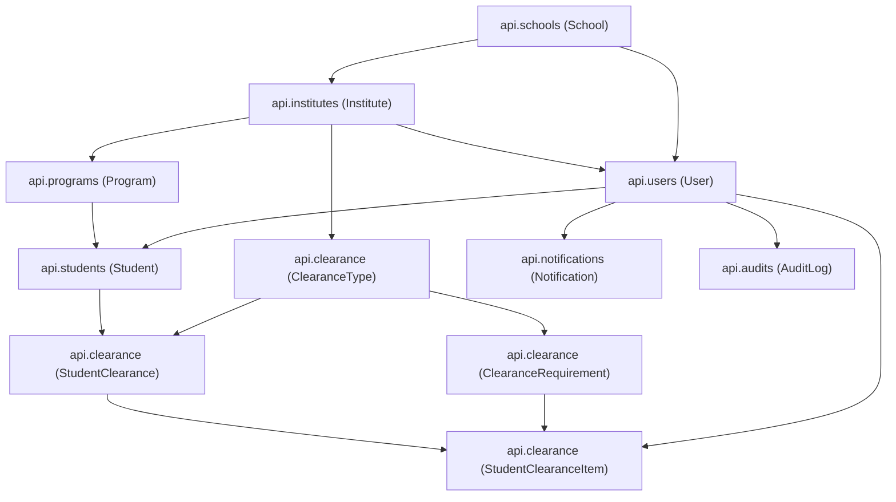

# E-Clearance Backend: Clean Slate Purge Plan (Approach B)

## 1. Executive Summary

This plan outlines the complete decoupling, directory removal, and migration reset for the **Institute of Computing E-Clearance System Backend**. 

By purging the 13 sibling applications (lockers, attendance, CMS fee collections, posts, coupons, complaints) and resetting historical migrations, the repository will transition from a multi-system monolithic fork into a lean, highly specialized, and production-ready E-Clearance backend.

---

## 2. Scope & App Inventory

### A. Apps Retained (E-Clearance Core & Platform Engine)

| App | Responsibility | Models / Key Features |
| :--- | :--- | :--- |
| **`api.clearance`** | Core Clearance Engine | `ClearanceType`, `ClearanceRequirement`, `StudentClearance`, `StudentClearanceItem`, sequential signing, Cloudinary proof uploads, PDF certificates, QR verification. |
| **`api.users`** | Identity & Authentication | Custom `User` model, JWT tokens, invitations, password hashing with versioned peppers. |
| **`api.students`** | Student Profiles | `Student` model, year levels, program association. |
| **`api.institutes`** | Academic Institutes | `Institute` model (e.g. Institute of Computing). |
| **`api.programs`** | Academic Programs | `Program` model (e.g. BSIT). |
| **`api.schools`** | Academic School Entity | `School` and `SchoolBuilding` models. |
| **`api.rbac`** | Access Control & Scoping | Role-based permissions, multi-tenancy institute scoping (`scope_queryset`), Django auth groups. |
| **`api.notifications`** | In-App Notifications | `Notification`, `NotificationBroadcast`, deficiency alerts, proof submission notifications. |
| **`api.audits`** | Audit Trail | `AuditLog` model, immutable activity history for clearance events. |
| **`api.reports`** | PDF Rendering Engine | `render_pdf()`, `xhtml2pdf` integration, base styles. |
| **`api.system_settings`** | Tenant Configuration | Per-institute settings. |
| **`api.change_password`** | Password Self-Service | Password reset via email OTP/token. |
| **`api.change_email`** | Email Self-Service | Email change confirmation. |
| **`api.health`** | Health Monitoring | `/health/ready/`, `/health/live/` endpoints. |
| **`api.seeding`** | Data Provisioning | `seed_all` command and seeder base classes. |
| **`api.utils`** | Shared Utilities | Versioned Cloudinary storage, pagination classes. |
| **`core`** | System Scaffolding | `BaseModel`, `ActorStampedModel`, choices, email senders. |

### B. Directories to Permanently Remove (13 Sibling Systems + Obsolete Helpers)

- `api/attendance_events`
- `api/attendance_records`
- `api/collection_categories`
- `api/complaints`
- `api/contributions`
- `api/coupons`
- `api/fees`
- `api/institutes_attendance_events`
- `api/institutes_attendance_event_settings`
- `api/locker_system`
- `api/payment_submissions`
- `api/payments`
- `api/posts`
- `api/summaries`
- `api/transfer_token`
- `api/clearance/services/adapter_compat_service.py` *(retired n8n bridge)*
- `api/clearance/services/n8n_gateway.py` *(retired n8n bridge)*

---

## 3. Dependency Architecture Graph

The retained applications form a strict, acyclic dependency graph with zero circular references:

---

## 4. Phase-by-Phase Execution Checklist

### Phase 1: Code Decoupling & Import Cleanup
- [x] **1.1** In `api/students/views.py`, remove `Fee` and `FeeReadSlimSerializer` imports; remove `fees_summary` and `student_pending_fees` actions.
- [x] **1.2** In `api/students/serializers.py`, remove unused imports (`CollectionCategoryMiniSerializer`, `Fee`).
- [x] **1.3** In `api/notifications/service.py`, remove `Fee` import and legacy broadcast functions (`broadcast_pending_fees`, `broadcast_overdue_fees`).
- [x] **1.4** In `api/notifications/notification_broadcast_viewset.py`, remove `pending-fees` and `notify-overdue-fees` actions.
- [x] **1.5** In `api/utils/cloudinary/paths.py`, remove `Post` from `_models()` and remove obsolete kinds (`POSTS`, `GCASH_ACCOUNTS`, `PAYMENTS`).
- [x] **1.6** In `config/settings/base.py`, remove the 13 pruned apps from `INSTALLED_APPS` and remove obsolete enum overrides in `SPECTACULAR_SETTINGS`.
- [x] **1.7** In `api/clearance/services/`, delete obsolete n8n compat files (`adapter_compat_service.py`, `n8n_gateway.py`, `compat_urls.py`, `compat_views.py`, `test_bridge.py`).

### Phase 2: Router & Root Views Cleanup
- [x] **2.1** In `api/urls.py`, remove all commented router registrations, remove unused imports from sibling apps, and remove `path("", include("api.reports.urls"))`.
- [x] **2.2** In `api/views/__init__.py`, remove re-exports of deleted viewsets.

### Phase 3: Directory Deletion
- [x] **3.1** Permanently delete the 13 sibling app directories:
  - `api/attendance_events`
  - `api/attendance_records`
  - `api/collection_categories`
  - `api/complaints`
  - `api/contributions`
  - `api/coupons`
  - `api/fees`
  - `api/institutes_attendance_events`
  - `api/institutes_attendance_event_settings`
  - `api/locker_system`
  - `api/payment_submissions`
  - `api/payments`
  - `api/posts`
  - `api/summaries`
  - `api/transfer_token`

### Phase 4: Migration Reset
- [x] **4.1** Delete all old migration files across all remaining apps (preserving each app's `__init__.py`).
- [x] **4.2** Run `python manage.py makemigrations` to generate clean, unified `0001_initial.py` migrations for:
  - `api.rbac`
  - `api.schools`
  - `api.institutes`
  - `api.programs`
  - `api.users`
  - `api.students`
  - `api.system_settings`
  - `api.audits`
  - `api.notifications`
  - `api.clearance`

### Phase 5: Fresh Database Setup & Seeding
- [x] **5.1** Reset database (drop all tables or clear SQLite file).
- [x] **5.2** Run `python manage.py migrate` to create clean schema.
- [x] **5.3** Run `python manage.py seed_all` to verify clean seeder execution.

### Phase 6: Verification & Quality Assurance
- [x] **6.1** Run `python manage.py test api.clearance.tests` (verify all 24 unit tests pass).
- [x] **6.2** Run `python manage.py spectacular --file schema.yml` (verify 0 schema errors).
- [x] **6.3** Run `python manage.py check` (verify system check passes with 0 issues).
