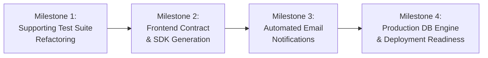

# E-Clearance Backend: Post-Purge Production Roadmap

## 1. Overview & Objective

Following the successful execution of **The Clean Slate Purge**, the E-Clearance System API now features a dedicated domain model, sequential signing workflow, state machine, proof upload/removal engine, PDF completion certificate generator, and QR verification.

This roadmap outlines the next 4 sequential milestones to elevate the system from a clean core engine to a fully verified, integrated, and production-deployed platform.

---

## 2. Roadmap Architecture & Phases

---

## 3. Phase-by-Phase Checklist

### Milestone 1: Supporting Test Suite Refactoring
**Goal**: Eliminate all leftover references to deleted apps in retained test files so that running `python manage.py test` executes cleanly with **100% pass rate across the entire repository**.

- [ ] **1.1** `api/institutes/tests.py`:
  - Replace `from api.fees.tests.factories import make_institute` with local institute factory helpers.
- [ ] **1.2** `api/audits/tests.py`:
  - Update permission assertions and roles to use `Roles.CLEARANCE_ADMIN` / `Roles.INSTITUTE_ADMIN` instead of legacy CMS roles (`Roles.CMS_ADMIN`).
  - Align audit search and retrieve assertions with current pagination and serializer field names.
- [ ] **1.3** `api/system_settings/tests.py`:
  - Remove assertions referencing deleted coupon/fee endpoints (`/api/v1/coupon-batches/`).
  - Keep settings scoping and maintenance switch tests relevant to clearance and tenant settings.
- [ ] **1.4** `api/rbac/tests.py`:
  - Update permission code assertions from deleted sibling models (`fees.waive_fee`, `payments.add_payment`, `contributions.add_contribution`) to clearance and platform permissions.
- [ ] **1.5** Global Test Suite Run:
  - Run full test suite: `python manage.py test` to verify 0 failures and 0 errors across all retained apps.

---

### Milestone 2: Frontend Integration & Contract Export
**Goal**: Provide the frontend team with clean, versioned OpenAPI contracts and verified network configuration for immediate integration.

- [ ] **2.1** OpenAPI Schema Export:
  - Generate standalone `openapi-schema.json` and `openapi-schema.yaml` via `drf-spectacular`.
  - Validate endpoints, tags, and request/response models.
- [ ] **2.2** API Component Naming Cleanup:
  - Address schema component collision warnings (e.g. `GroupSlimSerializer` between users and clearance).
- [ ] **2.3** CORS & Network Verification:
  - Verify `CORS_ALLOWED_ORIGINS` in `config/settings/local.py` against standard dev ports (`http://localhost:5173`, `http://localhost:3000`).
  - Verify cookie/JWT bearer token headers in Swagger UI interactive testing.

---

### Milestone 3: Automated Transactional Email Alerts
**Goal**: Configure SMTP via Gmail App Password (`froydcarbajosa14@gmail.com`) and supplement in-app notifications with automated email delivery for critical student milestones.

- [ ] **3.1** Gmail App Password & SMTP Setup:
  - Guide user through generating an App Password in Google Account Security.
  - Configure `EMAIL_HOST_USER`, `EMAIL_HOST_PASSWORD`, and `DEFAULT_FROM_EMAIL` in `.env`.
- [ ] **3.2** Rejection Notice Email:
  - Send an automated email when a signatory rejects a requirement item with remarks (`item.rejection_reason`).
  - Direct student to sign in and submit settlement proof.
- [ ] **3.3** Clearance Completion & Certificate Email:
  - Send an automated congratulatory email when the student's final requirement is cleared and status transitions to `CLEARED`.
  - Attach the minted PDF Completion Certificate directly to the outgoing email.
- [ ] **3.4** Async Email Delivery & Resilience:
  - Ensure emails utilize background threading (`EMAIL_SEND_ASYNC=True`) so API request-response times remain under 200ms.
  - Fall back gracefully if SMTP is unreachable without blocking clearance state transitions.
- [ ] **3.5** Unit Tests for Email Dispatch:
  - Add test cases in `api/clearance/tests.py` using `django.core.mail.outbox` to verify email generation, subject, recipient, and attachments.

---

### Milestone 4: Production Database & Deployment Readiness
**Goal**: Prepare the backend for MySQL / MariaDB (XAMPP) production operation beyond the local SQLite test environment.

- [ ] **4.1** Target Database Configuration (MySQL / MariaDB):
  - Configure MySQL database connection in `.env` (`DB_ENGINE=django.db.backends.mysql`, `DB_NAME`, `DB_USER=root`, `DB_PASSWORD`, `DB_HOST=127.0.0.1`, `DB_PORT=3306`).
  - Verify `mysqlclient` / `pymysql` driver connection.
  - Run `python manage.py migrate` on MySQL to verify clean table generation, composite indices, and foreign key constraints.
  - Run `python manage.py seed_all` on MySQL to verify full data provisioning.
- [ ] **4.2** Cloudinary Production Environment:
  - Verify live Cloudinary credentials in `.env` (`CLOUDINARY_CLOUD_NAME`, `CLOUDINARY_API_KEY`, `CLOUDINARY_API_SECRET`).
  - Test real upload and delete lifecycle of clearance proof attachments.
- [ ] **4.3** Production Settings & Security Audit:
  - Audit `config/settings/production.py` (`DEBUG=False`, `ALLOWED_HOSTS`, `SECRET_KEY`, `SECURE_SSL_REDIRECT`, `CSRF_COOKIE_SECURE`).
  - Verify password pepper configuration (`PASSWORD_PEPPER_1`).
- [ ] **4.4** Background Maintenance & Cleanup Tasks:
  - Verify management command for cleaning expired JWT blacklist tokens (`manage.py flushexpiredtokens`).
  - Document deployment guide, operational runbook, and environment variables.
