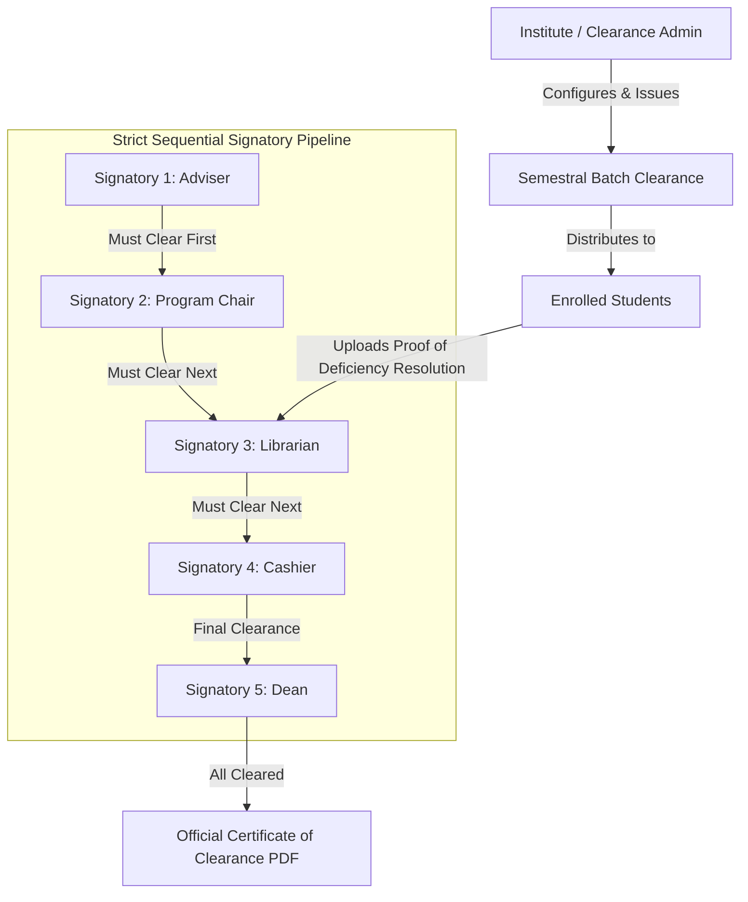
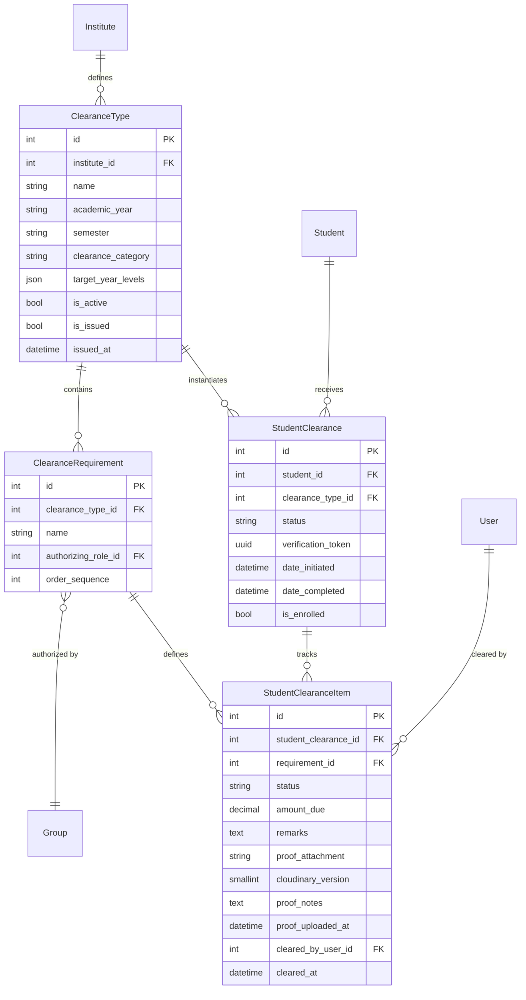

# E-Clearance System API: Comprehensive PRD, TDD & Implementation Roadmap

**Document Version:** 1.0.0  
**Target Architecture:** Dedicated Standalone E-Clearance Backend (Forked from `dnsc_systems_api`)  
**Scope:** Semestral Clearance MVP (Extensible for Special Clearance)  
**Status:** Approved for Implementation Planning  

---

## Table of Contents
1. [Product Requirements Document (PRD)](#1-product-requirements-document-prd)
   - [1.1 Purpose & Vision](#11-purpose--vision)
   - [1.2 User Personas & Permissions](#12-user-personas--permissions)
   - [1.3 Core Workflows & Business Rules](#13-core-workflows--business-rules)
   - [1.4 Feature Specifications & Acceptance Criteria](#14-feature-specifications--acceptance-criteria)
2. [Technical Design Document (TDD)](#2-technical-design-document-tdd)
   - [2.1 Domain Data Architecture](#21-domain-data-architecture)
   - [2.2 Sequential Signing & Authorization Engine](#22-sequential-signing--authorization-engine)
   - [2.3 Clearance State Machine & Automation Triggers](#23-clearance-state-machine--automation-triggers)
   - [2.4 Self-Contained Deficiencies & Proof Attachments](#24-self-contained-deficiencies--proof-attachments)
   - [2.5 Clearance Certificate PDF Generation & QR Verification](#25-clearance-certificate-pdf-generation--qr-verification)
   - [2.6 Codebase Pruning & Isolation Strategy](#26-codebase-pruning--isolation-strategy)
3. [Step-by-Step Execution Plan & Milestone Roadmap](#3-step-by-step-execution-plan--milestone-roadmap)
4. [Verification, Quality Assurance & Security Checklist](#4-verification-quality-assurance--security-checklist)

---

# 1. Product Requirements Document (PRD)

## 1.1 Purpose & Vision
The **Institute of Computing E-Clearance System** replaces cumbersome, paper-based semestral clearance slips with an automated, transparent, and auditable digital clearance workflow. 

### Core Objectives
* **Eliminate Physical In-Person Queues:** Allow students to track requirements and submit deficiency compliance proof digitally.
* **Strict Sequential Accountability:** Guarantee that departmental and institutional signatories sign off in the precise sequence mandated by university policy.
* **Deficiency Transparency:** Provide students with itemized deficiency remarks and amounts due (fines, unreturned books, lab clearance) without relying on external payment gateways for the MVP.
* **Verifiable Certification:** Instantly generate an official, tamper-proof Certificate of Clearance with an encrypted verification QR code upon 100% completion.

---

## 1.2 User Personas & Permissions



### 1. Student (Applicant)
* **Access:** Restricted to their own records via linked `user` account.
* **Capabilities:**
  * View active semestral clearance status and real-time progress percentage.
  * Inspect individual requirement statuses (`pending`, `cleared`, `has_issue`).
  * Read deficiency remarks and amounts due flagged by signatories.
  * Upload compliance proof (receipt photos, return slips, clearance notes).
  * Download official Certificate of Clearance PDF once status reaches `completed`.

### 2. Clearance Signatory (Adviser, Chair, Librarian, Cashier, Dean, Governor)
* **Access:** Restricted to clearance items matching their assigned `authorizing_role` and institute.
* **Capabilities:**
  * View actionable clearance queues (students whose *prior* sequential requirements are already cleared).
  * Sign off / clear requirements (`status = cleared`).
  * Flag deficiencies (`status = has_issue`) with mandatory remarks and optional `amount_due`.
  * Review student-submitted proof attachments.
  * Batch sign off compliant students.

### 3. Clearance Administrator / Institute Admin
* **Access:** Full administrative control over clearance within their institute scope.
* **Capabilities:**
  * Create and configure Clearance Types (Academic Year, Semester, Target Year Levels).
  * Define and reorder Clearance Requirements and map them to signatory Roles.
  * Execute batch issuance of clearance to all enrolled students in target programs.
  * Monitor institute-wide clearance completion rates and generate analytical audit reports.
  * Manually intervene or override clearance items when authorized.

---

## 1.3 Core Workflows & Business Rules

### Rule 1: Strict Sequential Progression
1. Every requirement within a Clearance Type has an explicit `order_sequence` (e.g., 1 = Adviser, 2 = Program Chair, 3 = Librarian, 4 = Cashier, 5 = Dean).
2. A signatory for requirement $N$ **cannot sign off** a student unless all requirements with `order_sequence < N` are marked as `cleared`.
3. If an earlier requirement is reverted (e.g. from `cleared` back to `has_issue`), subsequent requirements remain locked, and the overall clearance cannot complete.

### Rule 2: Self-Contained Deficiencies (Option A)
1. Signatories can flag a deficiency by marking the item as `has_issue`, entering descriptive `remarks`, and optionally setting an `amount_due` (e.g., PHP 150.00).
2. Students can resolve issues by uploading an attachment (image/PDF proof) with explanatory notes.
3. Once the signatory inspects the proof and verifies resolution, they change the status to `cleared`.

### Rule 3: Automated State Transitions
1. When all child clearance items for a student are marked `cleared`, `StudentClearance.status` transitions automatically to `completed`, recording `date_completed = timezone.now()`.
2. If any item is marked `has_issue`, the clearance status reflects deficiency blocking.

---

## 1.4 Feature Specifications & Acceptance Criteria

| Feature ID | Feature Description | Acceptance Criteria |
| :--- | :--- | :--- |
| **FR-01** | Semestral Clearance Batch Issuance | Admin selects term and target year levels $\rightarrow$ System generates `StudentClearance` and child `StudentClearanceItem` records for all matching enrolled students in bulk. Existing records are skipped idempotently. |
| **FR-02** | Sequential Sign-Off Enforcement | API rejects any sign-off request with `400 Bad Request` if any lower `order_sequence` requirement is not `cleared`. |
| **FR-03** | Signatory Dashboard Queues | Dashboard only surfaces students who are **actionable** (all predecessor requirements are cleared) to prevent cluttering signatories with premature records. |
| **FR-04** | Deficiency Flagging & Self-Service Proof Upload | Signatory flags `has_issue` with remarks $\rightarrow$ Student uploads image/PDF proof via Cloudinary $\rightarrow$ Signatory reviews attachment directly on the item. |
| **FR-05** | Real-Time Tracker for Students | `/api/v1/student-clearances/my-clearances/` returns clearance checklist with progress bar (`cleared_count / total_count`), current bottleneck signatory, and remarks. |
| **FR-06** | Certificate of Clearance PDF | Generates standardized PDF with student details, academic year, semester, signatory names, timestamps, and a verification QR code. Only available when `status == completed`. |
| **FR-07** | Public QR Verification | Scanning the QR code points to `/api/v1/student-clearances/verify/<uuid>/` displaying authenticated verification metadata confirming student clearance legitimacy. |

---

# 2. Technical Design Document (TDD)

## 2.1 Domain Data Architecture



### Model Enhancements
1. **`ClearanceType`** ([`api/clearance/models.py#L19`](file:///C:/xampp/htdocs/e-clearance_system_api/api/clearance/models.py#L19)):
   * Add `clearance_category = models.CharField(max_length=30, default="semestral", choices=[("semestral", "Semestral"), ("graduation", "Graduation"), ("transfer", "Transfer")])` — keeps MVP focused while immediately scalable.
2. **`StudentClearance`** ([`api/clearance/models.py#L101`](file:///C:/xampp/htdocs/e-clearance_system_api/api/clearance/models.py#L101)):
   * Add `verification_token = models.UUIDField(default=uuid.uuid4, unique=True, editable=False, db_index=True)` for secure QR verification links.
3. **`StudentClearanceItem`** ([`api/clearance/models.py#L154`](file:///C:/xampp/htdocs/e-clearance_system_api/api/clearance/models.py#L154)):
   * Add `proof_attachment = models.CharField(max_length=255, null=True, blank=True)`
   * Add `cloudinary_version = models.PositiveSmallIntegerField(null=True, blank=True)`
   * Add `proof_notes = models.TextField(null=True, blank=True)`
   * Add `proof_uploaded_at = models.DateTimeField(null=True, blank=True)`

---

## 2.2 Sequential Signing & Authorization Engine

### Strict Sequential Validation Logic
In [`api/clearance/views.py`](file:///C:/xampp/htdocs/e-clearance_system_api/api/clearance/views.py), within `StudentClearanceItemViewSet`:

```python
def validate_sequential_clearance(item: StudentClearanceItem):
    """
    Ensures all requirements with lower order_sequence are CLEARED
    before this item can be cleared.
    """
    preceding_uncleared = StudentClearanceItem.objects.filter(
        student_clearance=item.student_clearance,
        requirement__order_sequence__lt=item.requirement.order_sequence,
    ).exclude(status=StudentClearanceItem.ItemStatus.CLEARED)

    if preceding_uncleared.exists():
        first_blocking = preceding_uncleared.select_related("requirement").first()
        raise ValidationError({
            "detail": f"Sequential clearance locked: '{first_blocking.requirement.name}' (Step {first_blocking.requirement.order_sequence}) must be cleared first."
        })
```

### Signatory Dashboard Queue Optimization
In `signatory_dashboard`, instead of showing all pending items, add an `is_actionable` filter:
```python
# A pending item is actionable if no uncleared items exist with lower order_sequence
uncleared_predecessors = StudentClearanceItem.objects.filter(
    student_clearance=OuterRef("student_clearance"),
    requirement__order_sequence__lt=OuterRef("requirement__order_sequence"),
).exclude(status=StudentClearanceItem.ItemStatus.CLEARED)

queryset = queryset.annotate(
    has_uncleared_predecessor=Exists(uncleared_predecessors)
).filter(has_uncleared_predecessor=False)
```

---

## 2.3 Clearance State Machine & Automation Triggers

### Automated Status Evaluator
A centralized service function in `api/clearance/services/status_service.py`:

```python
@transaction.atomic
def evaluate_student_clearance_status(student_clearance: StudentClearance) -> StudentClearance:
    items = list(student_clearance.items.select_related("requirement"))
    total_items = len(items)
    
    if total_items == 0:
        return student_clearance

    cleared_count = sum(1 for item in items if item.status == StudentClearanceItem.ItemStatus.CLEARED)
    has_issues = any(item.status == StudentClearanceItem.ItemStatus.HAS_ISSUE for item in items)
    
    old_status = student_clearance.status

    if cleared_count == total_items:
        student_clearance.status = StudentClearance.ClearanceStatus.COMPLETED
        if not student_clearance.date_completed:
            student_clearance.date_completed = timezone.now()
    elif has_issues:
        student_clearance.status = StudentClearance.ClearanceStatus.IN_PROGRESS
    else:
        student_clearance.status = StudentClearance.ClearanceStatus.IN_PROGRESS if cleared_count > 0 else StudentClearance.ClearanceStatus.PENDING

    if student_clearance.status != old_status:
        student_clearance.save(update_fields=["status", "date_completed", "updated_at"])
        
        # Trigger notification & audit trail
        AuditLogService.log_action(
            system=AuditLog.System.CLEARANCE,
            entity_type="StudentClearance",
            entity_id=student_clearance.id,
            action=AuditLog.Action.UPDATE,
            actor_type=AuditLog.ActorTypeChoices.SYSTEM,
            old_values={"status": old_status},
            new_values={"status": student_clearance.status},
        )
        
    return student_clearance
```

---

## 2.4 Self-Contained Deficiencies & Proof Attachments

### Proof Upload Workflow
1. **Endpoint:** `POST /api/v1/student-clearance-items/{id}/upload-proof/`
2. **Permission:** Only the student who owns `student_clearance.student` can upload.
3. **Payload:** Multipart form containing `file` (image/jpeg, image/png, application/pdf) and optional `proof_notes`.
4. **Storage:** Calls `api.utils.cloudinary.cloudinary_utils.upload_image()` storing the asset under `clearance/proofs/{student_id}/`.
5. **Item Update:** Sets `proof_attachment = public_id`, `cloudinary_version = current_version`, `proof_uploaded_at = timezone.now()`.
6. **Notification:** Sends in-app alert via `notify_user()` to users in the requirement's `authorizing_role`.

---

## 2.5 Clearance Certificate PDF Generation & QR Verification

### PDF Rendering Pipeline
* **Endpoint:** `GET /api/v1/student-clearances/{id}/certificate/`
* **Security:** Returns 403 Forbidden unless `student_clearance.status == StudentClearance.ClearanceStatus.COMPLETED`.
* **Rendering Engine:** Uses [`api/reports/services/pdf.py`](file:///C:/xampp/htdocs/e-clearance_system_api/api/reports/services/pdf.py) (`xhtml2pdf`) with template `core/templates/clearance/certificate.html`.
* **QR Code:** Using `segno`:
  ```python
  import io, segno
  verify_url = f"{settings.FRONTEND_URL}/clearance/verify/{student_clearance.verification_token}"
  qr = segno.make(verify_url, error='h')
  buffer = io.BytesIO()
  qr.save(buffer, kind='png', scale=4)
  qr_base64 = base64.b64encode(buffer.getvalue()).decode()
  ```

### Public Verification Endpoint
* **Endpoint:** `GET /api/v1/student-clearances/verify/{verification_token}/`
* **Permission:** `AllowAny` (Public read-only).
* **Payload Response:**
  ```json
  {
    "valid": true,
    "student_name": "Juan Dela Cruz",
    "student_id": "2024-00123",
    "program": "Bachelor of Science in Information Technology",
    "academic_year": "2026-2027",
    "semester": "1st",
    "clearance_type": "Semestral Clearance",
    "date_completed": "2026-10-29T08:30:00Z",
    "signatories": [
      {"role": "Adviser", "name": "Dr. Smith", "signed_at": "2026-10-25T10:00:00Z"},
      {"role": "Program Chair", "name": "Prof. Davis", "signed_at": "2026-10-26T14:30:00Z"},
      {"role": "Librarian", "name": "Ms. Johnson", "signed_at": "2026-10-27T09:15:00Z"},
      {"role": "Cashier", "name": "Mr. Roberts", "signed_at": "2026-10-28T11:00:00Z"},
      {"role": "Dean", "name": "Dr. Vance", "signed_at": "2026-10-29T08:30:00Z"}
    ]
  }
  ```

---

## 2.6 Codebase Pruning & Isolation Strategy

To keep the application lean and avoid confusion during development, we isolate the backend as follows:

```
Step 1: Keep Historical Migrations Intact
  └── Do NOT delete migration files of fees, lockers, or attendance (preserves db integrity).

Step 2: Unregister Sibling Endpoints in api/urls.py
  └── Comment out router registrations for lockers, attendance, posts, coupons, complaints.

Step 3: Remove Sibling Seeders from Default Bootstrap
  └── In api/seeding/management/commands/seed_all.py, limit execution to:
      seed_schools -> seed_institutes -> seed_programs -> seed_users -> seed_students -> seed_clearance.

Step 4: Hide Sibling Models from Swagger / OpenAPI
  └── drf-spectacular will only expose active clearance, identity, and student endpoints.
```

---

# 3. Step-by-Step Execution Plan & Milestone Roadmap

```
Milestone 1: Packaging & Code Health [COMPLETED]
  ├── [x] 1.1 Create api/clearance/__init__.py
  ├── [x] 1.2 Deprecate external n8n gateway and remove unused compat bridge routes
  └── [x] 1.3 Connect clearance viewsets to centralized rbac/scoping.py (scope_queryset)

Milestone 2: Sequential Workflow & State Machine [COMPLETED]
  ├── [x] 2.1 Add verification_token and clearance_category to models
  ├── [x] 2.2 Implement validate_sequential_clearance() in StudentClearanceItemViewSet
  ├── [x] 2.3 Implement evaluate_student_clearance_status() service
  ├── [x] 2.4 Secure perform_update() on StudentClearanceItemViewSet (cleared_by_user immutability)
  └── [x] 2.5 Filter signatory_dashboard to actionable students only

Milestone 3: Deficiency Resolution & Proof Uploads [COMPLETED]
  ├── [x] 3.1 Add proof_attachment and proof_notes fields to StudentClearanceItem
  ├── [x] 3.2 Implement POST upload-proof action using Cloudinary utility
  ├── [x] 3.3 Add notification hooks on has_issue and proof upload
  └── [x] 3.4 Integrate AuditLogService on every status transition

Milestone 4: PDF Certification, Verification & Testing (Days 6–7)
  ├── 4.1 Create certificate HTML template in core/templates/clearance/
  ├── 4.2 Implement GET certificate endpoint with segno QR generation
  ├── 4.3 Implement public GET verify/<verification_token>/ endpoint
  ├── 4.4 Prune api/urls.py sibling routes and update seed_all
  └── 4.5 Write comprehensive unit test suite covering end-to-end clearance lifecycle
```

---

# 4. Verification, Quality Assurance & Security Checklist

### 1. Test Suite Coverage Target
* `test_sequential_signing_enforced`: Verifies that attempting to clear Step 3 before Step 2 raises a `400 ValidationError`.
* `test_completion_state_machine`: Verifies that when the final item is cleared, `StudentClearance.status` transitions to `completed` and sets `date_completed`.
* `test_signatory_immutability`: Verifies that `cleared_by_user` cannot be spoofed in request JSON and always matches `request.user`.
* `test_proof_upload_ownership`: Verifies that Student B cannot upload proof to Student A's clearance item.
* `test_certificate_access_control`: Verifies that incomplete clearances return `403 Forbidden` when requesting certificate download.
* `test_qr_verification`: Verifies public lookup returns accurate signatory records for valid tokens and 404 for invalid tokens.

### 2. Security Audits
- [x] Password pepper hashing configured and active (`PASSWORD_PEPPERS` in `.env`).
- [x] Zero unauthenticated identity enumeration endpoints.
- [x] Signed Cloudinary upload paths isolated by institute/student ID.
- [x] Rate limiting applied to verification and certificate generation routes.
- [x] Row-level multi-tenancy enforced through `scope_queryset`.
