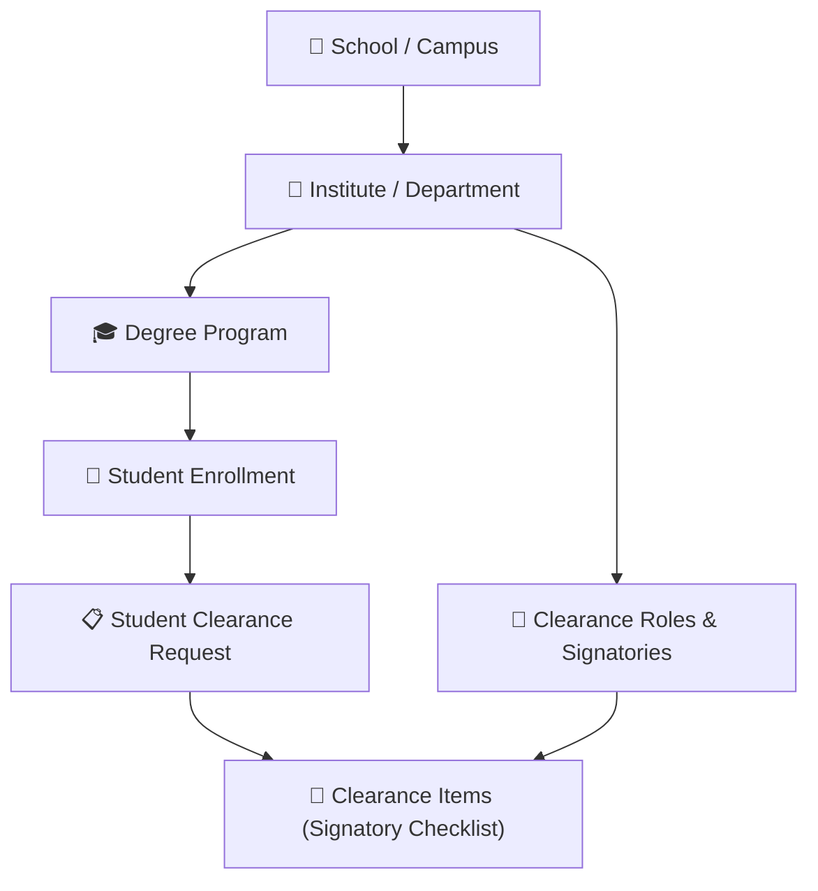
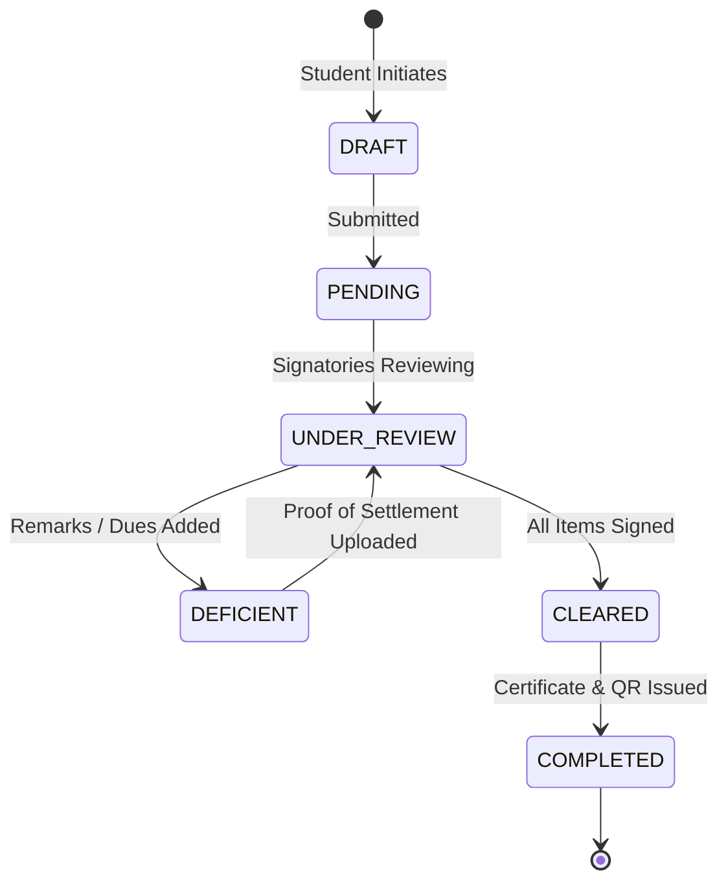

# E-Clearance System API

[](https://www.djangoproject.com/)
[](https://www.django-rest-framework.org/)
[](https://www.docker.com/)
[](https://www.mysql.com/)
[](https://render.com/)

A modern, multi-tenant digital clearance backend for educational institutions. Designed to automate and streamline the student academic clearance process with sequential approval workflows, deficiency tracking, proof upload settlement, transactional email alerts, digital certificate generation, and QR-based verification.

---

## 📑 Table of Contents

- [Overview & Architecture](#-overview--architecture)
- [Key Features](#-key-features)
- [Quick Start Guide](#-quick-start-guide)
  - [Prerequisites](#prerequisites)
  - [Local Installation](#local-installation)
  - [Environment Configuration](#environment-configuration)
  - [Database Setup & Seeding](#database-setup--seeding)
  - [Running the Application](#running-the-application)
- [Environment Modes](#-environment-modes-local-vs-production)
- [Database Management](#-database-management--seeding)
- [RBAC & Clearance Roles](#-role-based-access-control-rbac)
- [Security & Authentication](#-security--authentication)
- [Transactional Email Alerts](#-transactional-email-alerts)
- [Media Management (Cloudinary)](#-media-management-cloudinary)
- [API Reference & Documentation](#-api-reference--documentation)
- [Docker & Deployment](#-docker--deployment)
- [Testing & Quality Assurance](#-testing--quality-assurance)

---

## 🏛️ Overview & Architecture

The **E-Clearance System API** is built as an independent, domain-driven REST service. It supports hierarchical multi-tenancy:



Each clearance application transitions through a verified state machine:



---

## 🚀 Key Features

* **Sequential & Concurrent Approval Workflow**: Requirements can be configured as linear stages or concurrent sign-offs across university departments (e.g., Dean, Program Chair, Cashier, Librarian, Governor, Adviser).
* **Deficiency Management & Settlement**: Signatories can flag items with deficiencies (unreturned books, unpaid dues, missing records) with real-time proof-of-settlement uploads.
* **Certificate Generation with QR Verification**: Automated PDF certificate generation upon clearance completion (`xhtml2pdf`) embedded with cryptographically verified QR lookup URLs.
* **Transactional SMTP Email Delivery**: Asynchronous (`EMAIL_SEND_ASYNC=True`) notification engine alerting students on approval, deficiency remarks, and clearance completion.
* **Multi-Tenant Scoping**: Fine-grained role isolation ensuring School Admins and Signatories only view and manage records belonging to their respective institute or department.
* **Multi-Account Media CDN**: High-availability Cloudinary storage supporting automated versioning, zero-downtime key rotation, and per-tenant isolated folder structures.
* **Password Pepper & Security**: Defense-in-depth security using versioned HMAC-SHA256 password peppering, rotating JWT authentication with blacklisting, and strict CORS/CSRF protections.

---

## ⚡ Quick Start Guide

### Prerequisites

- **Python**: 3.12 or 3.13
- **Database**: MySQL 8.0+ or MariaDB 10.4+ (or SQLite for instant zero-dependency testing)
- **Git**

---

### Local Installation

1. **Clone the repository:**
   ```bash
   git clone https://github.com/carbajosafroyd/e-clearance_system_api.git
   cd e-clearance_system_api
   ```

2. **Create and activate a virtual environment:**
   * **Windows (PowerShell):**
     ```powershell
     python -m venv .venv
     .\.venv\Scripts\Activate.ps1
     ```
   * **macOS / Linux:**
     ```bash
     python3 -m venv .venv
     source .venv/bin/activate
     ```

3. **Install dependencies:**
   ```bash
   pip install --upgrade pip
   pip install -r requirements.txt
   ```

---

### Environment Configuration

Copy the example environment file:
```bash
cp .env.example .env
```

Ensure the following minimal settings are configured in `.env`:

```env
# Core runtime
DJANGO_ENV=local
DEBUG=True
DJANGO_SECRET_KEY=generate-a-strong-random-key-here
PASSWORD_PEPPER_1=generate-a-strong-random-pepper-here

# Database (choose SQLite or MySQL)
USE_SQLITE=True   # Set False if using MySQL / XAMPP

# URLs
BACKEND_URL=http://127.0.0.1:8000
FRONTEND_URL=http://localhost:5173
```

> [!TIP]
> Generate secure secrets directly from Python:
> ```bash
> python -c "import secrets; print(secrets.token_urlsafe(48))"
> ```

---

### Database Setup & Seeding

Run the self-healing bootstrap command to migrate and seed the foundational tenant hierarchy in one shot:

```bash
python manage.py bootstrap --essential
```

Want sample clearance templates, student records, and test sign-offs populated?
```bash
python manage.py seed_all
```

---

### Running the Application

Start the local development server:
```bash
python manage.py runserver
```

Open your browser:
* **Interactive Swagger UI**: [http://127.0.0.1:8000/api/docs/swagger/](http://127.0.0.1:8000/api/docs/swagger/)
* **ReDoc Documentation**: [http://127.0.0.1:8000/api/docs/redoc/](http://127.0.0.1:8000/api/docs/redoc/)
* **Django Admin**: [http://127.0.0.1:8000/admin/](http://127.0.0.1:8000/admin/)
* **Health Check Probe**: [http://127.0.0.1:8000/healthz](http://127.0.0.1:8000/healthz)

---

## 🔄 Environment Modes: Local vs. Production

Switching environments is handled seamlessly via `DJANGO_ENV` in `.env`:

| Setting | Local Development (`DJANGO_ENV=local`) | Production (`DJANGO_ENV=production`) |
| :--- | :--- | :--- |
| **`DEBUG`** | `True` (Detailed stack traces) | `False` (Safe production errors) |
| **`IS_DEPLOYED`** | `False` | `True` |
| **Security Headers** | Relaxed for `localhost` | Strict HTTPS redirect, HSTS, secure cookies |
| **Allowed Hosts** | `localhost`, `127.0.0.1`, `testserver` | Enforced via `DJANGO_ALLOWED_HOSTS` |
| **Static Assets** | Served dynamically by Django | Compressed & cached via **WhiteNoise** |
| **Database** | SQLite (`USE_SQLITE=True`) or local MySQL | Cloud-managed MySQL (e.g., Aiven / TiDB / RDS) |

---

## 🌱 Database Management & Seeding

### One-Command Bootstrapping

| Command | Purpose |
| :--- | :--- |
| `python manage.py bootstrap` | Runs migrations and seeds required RBAC roles. |
| `python manage.py bootstrap --essential` | Migrates and seeds foundational tenant data (Schools, Institutes, Programs, Admin accounts). |
| `python manage.py bootstrap --demo` | Sets up a fully populated test clearance environment with demo students and clearance records. |
| `python manage.py bootstrap --fresh` | **Full Reset**: Drops all existing tables, re-migrates from scratch, and seeds. |

### Individual Seeders

Seeders execute in strict dependency order:
```bash
python manage.py seed_rbac             # 1. Core permission catalog
python manage.py seed_schools          # 2. Campuses and campus buildings
python manage.py seed_institutes       # 3. Academic institutes / colleges
python manage.py seed_programs         # 4. Degree programs
python manage.py seed_users            # 5. Admin and staff role accounts
python manage.py seed_students         # 6. Student records
python manage.py seed_system_settings  # 7. Academic year, semester, toggles
python manage.py seed_clearance        # 8. Clearance types, items, and workflows
python manage.py seed_notifications   # 9. In-app notifications
python manage.py seed_audits           # 10. Audit trail logs
```

### Pre-Configured Demo Accounts

All seeded demo accounts are assigned the default development password: `password123`.

* **Superadmin**: `superadmin`
* **School Admin**: `<school>_admin` (e.g. `dnsc_admin`)
* **Institute Admin**: `<school>_<institute>_admin` (e.g. `dnsc_ic_admin`)
* **Clearance Signatories**:
  - Dean: `dnsc_ic_dean`
  - Program Chair: `dnsc_ic_programchair`
  - Cashier: `dnsc_ic_cashier`
  - Librarian: `dnsc_ic_librarian`
  - Governor: `dnsc_ic_governor`
  - Adviser: `dnsc_ic_adviser`
* **Students**: `student2026000001`, `student2026000002`, ...

---

## 🔐 Role-Based Access Control (RBAC)

Every endpoint in the system is protected by scoped role permissions. Tenancy is strictly enforced so that administrative users can only inspect and approve records within their assigned school or institute.

```
Superuser
  └── School Admin (Scoped to entire campus)
        └── Institute Admin (Scoped to specific college/institute)
              ├── Clearance Admin / Staff
              ├── Department Signatories (Dean, Cashier, Librarian, etc.)
              └── Students (Can only view and act on their own clearance records)
```

The live role and permission catalog can be inspected programmatically:
* `GET /api/v1/access/` — Lists all registered roles, permissions, and delegations.
* `GET /api/v1/me/` — Returns the authenticated user's profile, active roles, and granted permissions.

---

## 🛡️ Security & Authentication

* **HMAC-SHA256 Password Pepper**: Passwords are cryptographically blended with a secret pepper stored exclusively in the server environment before hashing. Supports seamless zero-downtime pepper rotation (`PASSWORD_PEPPER_CURRENT_VERSION`).
* **JWT Authentication with Auto-Rotation**: Short-lived access tokens (15m) paired with rotatable refresh tokens (31d). Compromised tokens are automatically added to the server-side blacklist.
* **Google OAuth2 Integration**: Allows direct student and staff sign-in using institutional Google accounts (`POST /api/v1/auth/google/`).
* **Rate Limiting & Throttling**: Strict IP and account-based throttling on authentication endpoints (`POST /api/v1/login/`) to mitigate brute-force attempts.
* **Audit Trail**: High-fidelity logging tracking administrative actions, approvals, rejections, and clearance certificate generation (`/api/v1/audit-logs/`).

---

## 📧 Transactional Email Alerts

The platform features an automated transactional email pipeline with asynchronous worker threads (`EMAIL_SEND_ASYNC=True`):

* **Clearance Deficiency Notice**: Immediately alerts a student when a signatory leaves remarks or flags an unpaid deficiency balance, with a direct link to submit settlement proof.
* **Clearance Completion & Certificate**: Automatically emails the student upon final sign-off, attaching the official PDF Clearance Certificate with an embedded verification QR code.
* **Invitation & Password Reset**: Sends one-time activation links and secure password reset codes.
* **Per-Tenant Sender Customization**: Each institute can designate its own outgoing Gmail account and app password, falling back to the institution default if unconfigured.

---

## ☁️ Media Management (Cloudinary)

Media assets (student avatars, institutional seals, clearance deficiency receipts, and clearance PDFs) are managed through a versioned Cloudinary integration.

* **Multi-Account Failover**: Configure multiple Cloudinary accounts (`CLOUDINARY_CLOUD_NAME_1`, `CLOUDINARY_CLOUD_NAME_2`, etc.) to automatically scale beyond free-tier quotas.
* **Deterministic Folder Hierarchy**:
  ```
  schools/<school_id>/logos/
  schools/<school_id>/institutes/<institute_id>/logos/
  schools/<school_id>/institutes/<institute_id>/students/<student_id>/clearance/
  ```
* **Auto-Purge Cascades**: Deleting an institute or student cleanly removes all corresponding CDN assets via prefix sweeps.

---

## 🗺️ API Reference & Documentation

| Resource / Endpoint | HTTP Method | Description |
| :--- | :--- | :--- |
| `/api/v1/login/` | `POST` | Authenticate with username/password to receive JWT pair. |
| `/api/v1/token/refresh/` | `POST` | Rotate and issue a fresh access token. |
| `/api/v1/auth/google/` | `POST` | Authenticate with Google OAuth2 ID token. |
| `/api/v1/me/` | `GET`, `PATCH` | Inspect current user profile and update avatar. |
| `/api/v1/student-clearances/` | `GET`, `POST` | List and initiate student clearance applications. |
| `/api/v1/student-clearance-items/`| `GET`, `PATCH`| Review, sign off, or flag deficiencies on clearance items. |
| `/api/v1/clearance-types/` | `GET`, `POST` | Manage clearance templates and requirements. |
| `/api/v1/clearance-roles/` | `GET`, `POST` | Assign signatory roles to staff members. |
| `/api/v1/notifications/` | `GET` | View user notifications and broadcast messages. |
| `/api/v1/audit-logs/report/` | `GET` | Export audit trail logs to Excel or PDF. |
| `/healthz` | `GET` | Fast liveness probe for monitoring and load balancers. |
| `/health/` | `GET` | Detailed diagnostic health check (DB, cache, version). |

Full request/response schemas are available interactively at `/api/docs/swagger/`.

---

## 🐳 Docker & Deployment

The repository includes a production-ready, security-hardened `Dockerfile` utilizing a non-root system user (`eclearance`) and WhiteNoise static compression.

### Building & Running with Docker

1. **Build the container image:**
   ```bash
   docker build -t e-clearance-api:latest .
   ```

2. **Run the container:**
   ```bash
   docker run -p 8000:8000 --env-file .env e-clearance-api:latest
   ```

### Deploying to Render

The service is pre-configured for one-click deployment on Render:
1. Create a new **Web Service** pointing to your repository.
2. Select **Docker** as the runtime.
3. In **Settings**:
   - **Health Check Path**: `/healthz`
   - **Docker Build Context Directory**: `.`
   - **Dockerfile Path**: `./Dockerfile`
4. In **Environment Variables**, supply your production database credentials (`DB_HOST`, `DB_NAME`, `DB_USER`, `DB_PASSWORD`), `DJANGO_SECRET_KEY`, `PASSWORD_PEPPER_1`, and `DJANGO_ENV=production`.

---

## 🧪 Testing & Quality Assurance

The codebase maintains rigorous automated test coverage across authentication, clearance state transitions, tenancy scoping, and PDF generation.

Run the complete test suite:
```bash
python manage.py test
```

Run test suites for specific modules:
```bash
python manage.py test api.clearance.tests    # Clearance state machine & approval workflow
python manage.py test api.rbac.tests         # Tenancy and permission scoping
python manage.py test api.health.tests       # Health check liveness probes
```

---

## 👥 Authors & Contributors

* **Lead Developer**: Froyd Carbajosa ([@carbajosafroyd](https://github.com/carbajosafroyd))
* **Institution**: Davao del Norte State College (DNSC)

---

## 📄 License

This project is licensed under the MIT License — see the [LICENSE](LICENSE) file for details.
