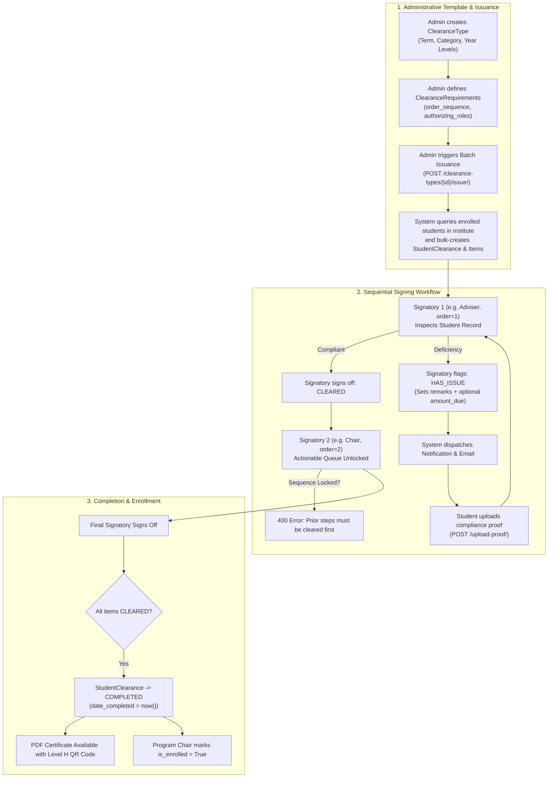

# Phase 1: Comprehensive Backend Architecture & Technical Implementation Analysis

**Document Code:** TECH-ANALYSIS-PHASE1  
**Target Repository:** `e-clearance_system_api`  
**Execution Date:** October 31, 2026  
**Status:** Completed & Verified  

---

## 1. Executive Summary & Architectural Overview

The backend implementation located in `C:\xampp\htdocs\e-clearance_system_api` is a production-grade, multi-tenant academic clearance management API built upon **Python 3.13**, **Django 6.0**, and **Django REST Framework (DRF) 3.16.1**.

Originally derived and isolated from a broader multi-system institutional infrastructure (`dnsc_systems_api`), the codebase has undergone a dedicated architectural consolidation ("The Clean Slate Purge") focusing specifically on the **E-Clearance System** domain while retaining shared foundational modules (RBAC, Multi-Tenancy Scoping, Audit Logging, Cloudinary Storage Versioning, and Notifications).

### Key Architectural Characteristics
* **Monolithic Clean Modular Architecture:** Django applications are organized under `api/` (clearance, users, students, rbac, audits, notifications, system_settings, schools, institutes, programs) and `core/` (base models, versioned password pepper, email service, tenant branding, choices).
* **Multi-Tenancy Hierarchy:** Institutional scoping enforces strict data boundaries: `School -> Institute -> Program -> Student / Clearance`.
* **Stateless Token-Based Authentication:** DRF SimpleJWT (`rest_framework_simplejwt`) utilizing HMAC-SHA256, rotating refresh tokens with blacklisting, and a multi-versioned server-side password pepper system.
* **Deterministic Sequential Workflow Engine:** clearance signing enforces a strictly ordered DAG (Directed Acyclic Graph) based on requirement sequences (`order_sequence`).
* **Automated State Machine:** State transitions (`pending` -> `in_progress` -> `completed` / `rejected`) are centrally orchestrated based on child item status evaluation.
* **Tamper-Evident Certification:** Automated generation of vector PDF certificates featuring Segno-rendered High Error-Correction (Level H) QR codes mapped to unique nonces (`verification_token` UUIDv4).

---

## 2. Technology Stack & Runtime Infrastructure

| Layer | Component | Version / Specification | Architectural Role |
| :--- | :--- | :--- | :--- |
| **Runtime Language** | Python | 3.13.x | Core execution environment |
| **Web Framework** | Django | 6.0.0 | High-level web framework, ORM, security middleware |
| **API Framework** | Django REST Framework | 3.16.1 | Serializers, ViewSets, API routing, exception handling |
| **Authentication** | djangorestframework-simplejwt | 5.5.1 | Stateless access token (15m) & refresh token (31d) lifecycle |
| **Relational Database** | MySQL / MariaDB (Prod) / SQLite (Dev) | MySQL 8.0+ / SQLite 3 | Persistent relational storage (`STRICT_TRANS_TABLES`, `utf8mb4`) |
| **Caching Layer** | Redis / Django LocMemCache | redis 8.1.0 | Shared distributed cache (Redis) or isolated per-process fallback |
| **Media / Asset Cloud** | Cloudinary | cloudinary 1.44.1 | Version-aware media storage for proof uploads & profile avatars |
| **Document Engine** | ReportLab & xhtml2pdf | reportlab 4.5.1, xhtml2pdf 0.2.17 | PDF certificate generation and audit log exports |
| **Digital Verification** | Segno QR Engine | segno 1.6.6 | Error-resilient QR generation embedding verification URLs |
| **API Documentation** | drf-spectacular | 0.29.0 | Automated OpenAPI 3.0 schema generation (Swagger UI & Redoc) |

---

## 3. Database Schema & Data Models

The system persistence schema is organized across the following core models:

### 3.1 Clearance Domain (`api/clearance/models.py`)

#### 1. `ClearanceType` (Table: `clearance_types`)
Represents an administrative clearance template issued for an academic period.
* Inherits from [`ActorStampedModel`](file:///C:/xampp/htdocs/e-clearance_system_api/core/BaseModel.py) (`created_at`, `updated_at`, `created_by`, `updated_by`).
* **Fields:**
  * `institute` (`ForeignKey` -> `Institute`, on_delete=PROTECT, nullable for platform-level): Scopes template to college/institute.
  * `name` (`CharField(100)`): E.g., *"1st Semester Semestral Clearance 2026-2027"*.
  * `description` (`TextField`, optional): Administrative notes.
  * `clearance_category` (`CharField(30)`, default=`"semestral"`): Choices: `semestral`, `graduation`, `transfer`.
  * `academic_year` (`CharField(20)`): E.g., `"2026-2027"`.
  * `semester` (`CharField(20)`): E.g., `"1st Semester"`, `"2nd Semester"`, `"Summer"`.
  * `is_active` (`BooleanField`, default=True): Master switch for student visibility.
  * `target_year_levels` (`JSONField`, default=list): List of integers (e.g. `[1, 2, 3, 4]`) validated via `validate_year_levels`.
  * `is_issued` (`BooleanField`, default=False): Indicates if bulk instantiation has been executed.
  * `issued_at` (`DateTimeField`, null=True): Timestamp of issuance execution.
* **Constraints & Indices:**
  * Unique constraint on `[institute, name, academic_year, semester]`.
  * Custom Permission: `clearance.issue_clearancetype` (*"Can issue a clearance to every eligible student"*).

#### 2. `ClearanceRequirement` (Table: `clearance_requirements`)
Defines the required sign-off checkpoints associated with a `ClearanceType`.
* Inherits from [`ActorStampedModel`](file:///C:/xampp/htdocs/e-clearance_system_api/core/BaseModel.py).
* **Fields:**
  * `clearance_type` (`ForeignKey` -> `ClearanceType`, on_delete=CASCADE, related_name=`"requirements"`).
  * `name` (`CharField(100)`): Requirement title (e.g., *"Library Clearance"*, *"Laboratory Equipment Check"*, *"Dean's Office"*).
  * `authorizing_role` (`ForeignKey` -> `auth.Group`, on_delete=PROTECT): Primary/legacy signing role.
  * `authorizing_roles` (`ManyToManyField` -> `auth.Group`, blank=True): Multi-role authorization list supporting delegated/shared signers.
  * `order_sequence` (`PositiveIntegerField`): Defines strict progression order ($1, 2, 3, \dots$).
* **Constraints & Indices:**
  * Unique constraints on `[clearance_type, name]` and `[clearance_type, order_sequence]`.
  * Ordered default: `["order_sequence", "id"]`.

#### 3. `StudentClearance` (Table: `student_clearances`)
Instantiates an active clearance record for an individual student.
* Inherits from [`ActorStampedModel`](file:///C:/xampp/htdocs/e-clearance_system_api/core/BaseModel.py).
* **Fields:**
  * `student` (`ForeignKey` -> `Student`, on_delete=CASCADE, related_name=`"student_clearances"`).
  * `clearance_type` (`ForeignKey` -> `ClearanceType`, on_delete=CASCADE).
  * `status` (`CharField(20)`, default=`"pending"`): Choices: `pending`, `in_progress`, `completed`, `rejected`.
  * `date_initiated` (`DateTimeField`, auto_now_add=True).
  * `date_completed` (`DateTimeField`, null=True, blank=True).
  * `verification_token` (`UUIDField`, default=`uuid.uuid4`, unique=True, indexed): Nonce for tamper-proof public QR verification.
  * `is_enrolled` (`BooleanField`, default=False): Downstream enrollment unlock flag.
  * `enrolled_at` (`DateTimeField`, null=True, blank=True).
  * `enrolled_by_user` (`ForeignKey` -> `User`, null=True, blank=True): Actor stamping for enrollment approval.
* **Constraints:**
  * Unique constraint on `[student, clearance_type]`.

#### 4. `StudentClearanceItem` (Table: `student_clearance_items`)
Tracks individual checkpoint sign-offs, deficiency remarks, amounts due, and proof uploads.
* Inherits from [`ActorStampedModel`](file:///C:/xampp/htdocs/e-clearance_system_api/core/BaseModel.py).
* **Fields:**
  * `student_clearance` (`ForeignKey` -> `StudentClearance`, on_delete=CASCADE, related_name=`"items"`).
  * `requirement` (`ForeignKey` -> `ClearanceRequirement`, on_delete=CASCADE).
  * `status` (`CharField(20)`, default=`"pending"`): Choices: `pending`, `cleared`, `has_issue`.
  * `amount_due` (`DecimalField(10, 2)`, null=True, blank=True): Deficiency fine/charge without external gateway lock.
  * `remarks` (`TextField`, null=True, blank=True): Signatory remarks explaining clearance status or deficiency.
  * `proof_attachment` (`CharField(255)`, null=True, blank=True): Cloudinary public identifier of compliance proof uploaded by student.
  * `cloudinary_version` (`PositiveSmallIntegerField`, null=True, blank=True): Cloudinary account version.
  * `proof_notes` (`TextField`, null=True, blank=True): Student explanation submitted alongside proof.
  * `proof_uploaded_at` (`DateTimeField`, null=True, blank=True).
  * `cleared_by_user` (`ForeignKey` -> `User`, null=True, blank=True): The exact staff member who authorized the item.
  * `cleared_at` (`DateTimeField`, null=True, blank=True).
* **Constraints & Permissions:**
  * Unique constraint on `[student_clearance, requirement]`.
  * Custom Permission: `clearance.sign_studentclearanceitem` (*"Can sign off a clearance requirement"*).

---

### 3.2 Student & Identity Domain (`api/students`, `api/users`)

#### 1. `Student` (Table: `students`)
* `s_studentID` (`CharField(10)`, unique=True, `MinLengthValidator(10)`): Formal student identification number.
* `program` (`ForeignKey` -> `Program`): Institutional academic degree program.
* `user` (`OneToOneField` -> `User`, null=True, blank=True): Links student profile to authentication user account.
* `s_rfid` (`CharField(10)`, unique=True, null=True): Optional physical RFID tag.
* `s_fname`, `s_mname`, `s_lname`, `s_suffix`: Full name elements.
* `s_lvl` (`PositiveIntegerField`): Current academic year level ($1, 2, 3, 4, 5$).
* `s_status` (`CharField(15)`, choices: `enrolled`, `graduated`, `dropped`, `to_be_updated`).
* `s_image`, `cloudinary_version`: Cloudinary-managed profile photo.

#### 2. `User` (Table: `users`)
* Custom user extending `AbstractUser` and `ActorStampedModel`.
* Versioned password pepper tracking via `pepper_version` (`core.pepper`).
* Scoped via `institute` (`ForeignKey` -> `Institute`) and `school` (`ForeignKey` -> `School`).
* Invitation and activation tokens managed via `UserRegistrationToken` (`user_registration_tokens` table) with temporary passwords and configurable expiration.

---

### 3.3 Supporting System Infrastructure

* **`AuditLog` (`audits` table):** Captures complete transactional event provenance (`system="clearance"`, `entity_type`, `entity_id`, `action`, `actor_type`, `actor_id`, `old_values`, `new_values`, `created_at`).
* **`Notification` & `NotificationBroadcast` (`notifications` table):** Dispatches real-time in-app alerts (`clearance.issue`, `clearance.proof_submitted`, `clearance.cleared`, `clearance.completed`).
* **`SystemSetting` (`system_settings` table):** Key-value tenant configuration with granular permissions for system maintenance shutters, academic term definitions, and bypass exemptions.

---

## 4. API Endpoints Specification

All clearance-specific endpoints are exposed under `/api/v1/`:

| HTTP Method | Route URL | View / Action | Permissions Required | Description / Purpose |
| :--- | :--- | :--- | :--- | :--- |
| **GET / POST** | `/api/v1/clearance-types/` | `ClearanceTypeViewSet.list / create` | `IsClearanceAdminOrReadOnly` | List clearance templates or create new type. |
| **GET / PUT / PATCH / DELETE** | `/api/v1/clearance-types/{id}/` | `ClearanceTypeViewSet.retrieve / update / destroy` | `IsClearanceAdminOrReadOnly` | Retrieve, update, or remove clearance type. |
| **POST** | `/api/v1/clearance-types/{id}/issue/` | `ClearanceTypeViewSet.issue` | `clearance.issue_clearancetype` | **Batch Issuance:** Generates `StudentClearance` & items for all matching enrolled students. |
| **GET** | `/api/v1/clearance-types/{id}/dashboard/` | `ClearanceTypeViewSet.dashboard` | `IsClearanceAdmin` | Analytical breakdown by program, year level, and bottlenecks. |
| **GET** | `/api/v1/clearance-types/admin-summary/` | `ClearanceTypeViewSet.admin_summary` | `IsClearanceAdmin` | Aggregate high-level statistics across all clearance types. |
| **GET / POST** | `/api/v1/clearance-requirements/` | `ClearanceRequirementViewSet` | `IsClearanceAdminOrReadOnly` | List or register requirements mapped to roles with sequence orders. |
| **GET / PUT / PATCH / DELETE** | `/api/v1/clearance-requirements/{id}/` | `ClearanceRequirementViewSet` | `IsClearanceAdmin` | Manage individual requirement definitions. |
| **GET** | `/api/v1/student-clearances/` | `StudentClearanceViewSet.list` | Authenticated (Scoped) | List clearances; auto-scoped to caller's institute/student identity. |
| **GET** | `/api/v1/student-clearances/my-clearances/` | `StudentClearanceViewSet.my_clearances` | `IsStudent` | Current student's active clearances and live checklists. |
| **GET** | `/api/v1/student-clearances/{id}/` | `StudentClearanceViewSet.retrieve` | Scoped Access | Detail view of clearance with pre-calculated completion progress. |
| **GET** | `/api/v1/student-clearances/{id}/certificate/` | `StudentClearanceViewSet.certificate` | Scoped Access | **PDF Certificate:** Downloads official clearance certificate with QR code (must be `completed`). |
| **GET** | `/api/v1/student-clearances/verify/{token}/` | `StudentClearanceViewSet.verify` | `AllowAny` (Public) | **Public QR Verification:** Returns validated clearance metadata confirming authenticity. |
| **POST** | `/api/v1/student-clearances/{id}/enroll/` | `StudentClearanceViewSet.enroll` | `Program Chair` or `Admin` | Marks clearance as enrolled once all items are completed. |
| **GET** | `/api/v1/student-clearances/program-chair-dashboard/`| `StudentClearanceViewSet.program_chair_dashboard`| Program Chair / Admin | Program-specific clearance completion metrics for enrollment screening. |
| **POST** | `/api/v1/student-clearances/bulk-by-ids/` | `StudentClearanceViewSet.bulk_by_ids` | Signatory / Admin | Fetches list of clearances by explicit ID list. |
| **GET** | `/api/v1/student-clearance-items/` | `StudentClearanceItemViewSet.list` | Signatory / Admin / Student | Query items with extensive filtering (`status`, `requirement`, `clearance_type`). |
| **GET** | `/api/v1/student-clearance-items/signatory-dashboard/`| `StudentClearanceItemViewSet.signatory_dashboard`| Signatory / Admin | Returns queue of actionable clearance items assigned to caller's role. |
| **PATCH / PUT** | `/api/v1/student-clearance-items/{id}/` | `StudentClearanceItemViewSet.update` | `sign_studentclearanceitem` | Sign off (`cleared`) or flag deficiency (`has_issue`), validated sequentially. |
| **POST** | `/api/v1/student-clearance-items/{id}/upload-proof/`| `StudentClearanceItemViewSet.upload_proof` | Item Student Owner | Student uploads compliance photo/PDF and explanatory notes to Cloudinary. |
| **POST** | `/api/v1/student-clearance-items/{id}/remove-proof/`| `StudentClearanceItemViewSet.remove_proof` | Student Owner / Admin | Clears uploaded proof asset and notes. |
| **GET** | `/api/v1/clearance-roles/` | `ClearanceRoleViewSet.list` | Admin / Staff | Catalog of eligible clearance signatory roles (Django Groups). |

---

## 5. Authentication, RBAC & Permissions Architecture

### 5.1 Authentication Flow
* **JWT Bearer Authentication:** Enforced on all protected views via `rest_framework_simplejwt.authentication.JWTAuthentication`.
* **Password Pepper Versioning:** Implemented in [`core/pepper.py`](file:///C:/xampp/htdocs/e-clearance_system_api/core/pepper.py). Passwords are pre-hashed with an environment-level pepper string before standard Django Argon2/PBKDF2 hashing. Seamlessly upgrades old password hashes on successful sign-in.
* **Google OAuth2 Support:** Integrated at `/api/v1/auth/google/` and `/api/v1/auth/google/register`.

### 5.2 Role-Based Access Control Matrix

The system implements explicit roles defined in [`api/rbac/roles.py`](file:///C:/xampp/htdocs/e-clearance_system_api/api/rbac/roles.py):

| Role Name | Description / Scope | Granted Clearance Authorities |
| :--- | :--- | :--- |
| **`Students`** | Enrolled student self-service. | Read own `StudentClearance` & `StudentClearanceItem`; upload/remove compliance proof; download certificate. |
| **`Clearance Management System Admins`** | Institute-level clearance administrator. | Full CRUD on `ClearanceType` & `ClearanceRequirement`; trigger batch issuance; view admin summary & analytics. |
| **`School Admins`** | School-wide super-administrator. | Inherits all clearance administrative powers across all institutes under the school. |
| **`Institute Admins`** | College Dean / Institute Director. | Scoped administration over all programs, students, and clearance templates in the institute. |
| **Signatories (`Librarians`, `Deans`, `Cashiers`, `Advisers`, `Program Chairs`, `Governors`)** | Authorized department evaluators. | Hold `clearance.sign_studentclearanceitem`; view actionable queues; sign off or flag deficiencies on items assigned to their group. |

### 5.3 Object-Level Scoping & Security Rules
Implemented in [`api/clearance/permissions.py`](file:///C:/xampp/htdocs/e-clearance_system_api/api/clearance/permissions.py) and [`api/rbac/scoping.py`](file:///C:/xampp/htdocs/e-clearance_system_api/api/rbac/scoping.py):
1. **Student Isolation:** A student account cannot inspect, query, or mutate any clearance record or item belonging to another student ID (`object_student_id(obj) == user.student.id`).
2. **Tenant Scoping:** Signatories and administrators are strictly restricted to students belonging to programs within their assigned `institute_id` (unless holding school-wide admin flags).
3. **Signatory Authorization Check:** An officer can sign off a `StudentClearanceItem` **only if** their assigned user groups match either `requirement.authorizing_role` or exist within `requirement.authorizing_roles`.

---

## 6. Business Logic & System Workflows



### 6.1 Strict Sequential Progression (`status_service.validate_sequential_clearance`)
* Every clearance requirement carries a strict numerical `order_sequence`.
* When an evaluator attempts to sign off an item as `cleared`, the service validates that **all preceding requirements** (`requirement__order_sequence < current_sequence`) are already marked as `cleared`.
* If any preceding requirement is `pending` or `has_issue`, the transaction is blocked with:
  ```json
  {
    "detail": "Sequential clearance locked: '<Preceding Name>' (Step X) must be cleared first."
  }
  ```

### 6.2 Self-Contained Deficiency Handling & Compliance Proof
* If a student owes fees, lost books, or failed to submit project deliverables, the signatory updates the item to `has_issue` with explanatory `remarks` and an optional `amount_due`.
* The system does not lock the workflow to an automated payment gateway; instead, students rectify deficiencies through physical compliance or digital proof submission (`POST /student-clearance-items/{id}/upload-proof/`).
* Uploading proof notifies the relevant signatories via [`notify_proof_submitted`](file:///C:/xampp/htdocs/e-clearance_system_api/api/clearance/services/notification_service.py#L76), allowing them to review the attachment and approve.

### 6.3 State Machine Transition Rules (`status_service.evaluate_student_clearance_status`)
Centralized in [`api/clearance/services/status_service.py`](file:///C:/xampp/htdocs/e-clearance_system_api/api/clearance/services/status_service.py):
* If **$100\%$ of items** are `cleared`:
  * `StudentClearance.status` $\rightarrow$ `completed`
  * `date_completed` $\rightarrow$ `timezone.now()`
  * Triggers completion notification & transactional completion email.
  * Writes `APPROVE` audit log entry.
* If **any item** is `has_issue` OR at least one item is `cleared` (partial progress):
  * `StudentClearance.status` $\rightarrow$ `in_progress`
  * `date_completed` $\rightarrow$ `None`
* If **zero items** are cleared and none has an issue:
  * `StudentClearance.status` $\rightarrow$ `pending`
  * `date_completed` $\rightarrow$ `None`

### 6.4 Certificate Generation & Tamper-Evident QR Verification
* Implemented in [`api/clearance/services/certificate_service.py`](file:///C:/xampp/htdocs/e-clearance_system_api/api/clearance/services/certificate_service.py).
* Available strictly when clearance status is `completed`.
* Generates a branded, vector-quality PDF embedding:
  * Institutional headers (DNSC, Institute, School).
  * Student biographical data and academic program.
  * Audit table of all completed items, sign-off timestamps, and signing officer names.
  * High-res Segno QR code pointing to `{FRONTEND_URL}/clearance/verify/{verification_token}`.
* Verification endpoint (`/api/v1/student-clearances/verify/{token}/`) is publicly accessible without authentication, enabling registrar staff to verify printed clearance slips by scanning the QR code with any smartphone camera.

### 6.5 Post-Clearance Enrollment Handoff
* Completed clearances allow Program Chairs or Administrators to invoke `POST /api/v1/student-clearances/{id}/enroll/`.
* Sets `is_enrolled = True`, stamps `enrolled_at = timezone.now()`, and records `enrolled_by_user`.
* Bridges the academic clearance process directly into semestral enrollment verification.

---

## 7. Analysis Findings Summary for Reconciling Documentation

From this technical inspection, the following critical baseline facts have been established:
1. **Batch Issuance vs. Student Initiation:** Clearance records are initiated via **administrative batch issuance** targeting enrolled students by academic year, semester, and year levels (`ClearanceType.issue`), rather than individual students creating clearance requests on demand.
2. **Sequential Signing Engine:** Requirement progression is strictly governed by `order_sequence`. The documentation must explicitly specify this sequential signing pipeline.
3. **Deficiency & Proof Lifecycle:** Deficiencies are handled natively via `has_issue`, `amount_due`, and Cloudinary-backed proof uploads directly within `StudentClearanceItem`.
4. **Digital Certification & QR Verification:** Built-in PDF generation and public verification endpoints (`/verify/<token>/`) are already implemented and operational.
5. **Enrollment Workflow:** Post-clearance enrollment status tracking (`is_enrolled`) is implemented directly in `StudentClearance`.

---
*End of Phase 1 Technical Analysis. Proceeding to Phase 2 (Document Analysis).*
