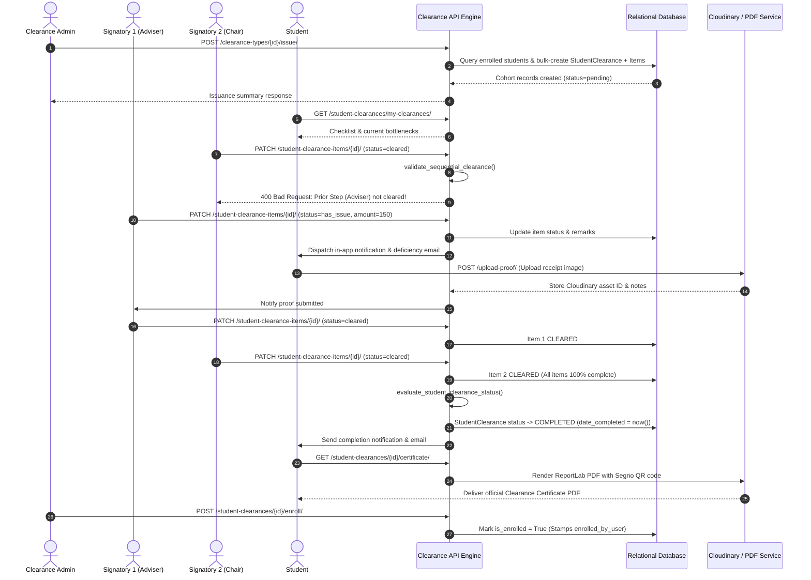

# Project Management Plan (PMP)
## ClearanceDNSC: Web-Based Student Clearance Management System

**Organization:** Davao del Norte State College (DNSC)  
**Project Name:** ClearanceDNSC  
**Document Type:** Project Management Plan with System Flow, Reconciled Architecture, and Requirements  
**Version / Date:** Version 2.0 (Reconciled Baseline) | October 31, 2026  
**Project Sponsor / Owner:** Institutional Stakeholders: Davao del Norte State College (DNSC)  
**Project Manager:** Elyza M. Flores  
**Technical Documentation Reviewer / Backend Lead:** Senior Backend Development Team  
**Project Status:** Active — Technical Architecture Reconciled & Baseline Verified  

---

## Document Control & Revision History

| Version | Date | Author / Role | Summary of Changes |
| :--- | :--- | :--- | :--- |
| **Draft 1.0** | Oct 28, 2026 | Elyza M. Flores (Project Manager) | Initial planning draft with high-level proposed requirements and system flow. |
| **Rev 2.0** | Oct 31, 2026 | Technical Documentation Reviewer | Reconciled document with verified Django 6.0 backend implementation (`e-clearance_system_api`). Reconciled cohort batch issuance workflow, sequential signing pipeline, self-contained deficiency tracking, tamper-evident QR verification, RBAC role catalog, and completed unfinished sections (Cost Management and Assumptions). |

---

## 1. Purpose and Management Approach

This Project Management Plan describes how **ClearanceDNSC** is planned, architecturally structured, developed, tested, demonstrated, and transitioned to institutional operation. 

The system is a dedicated, secure, web-based platform engineered to automate and streamline the academic clearance process at Davao del Norte State College (DNSC). It eliminates paper-based clearance forms by enabling administrators to batch-issue clearance cohorts, allowing students to monitor requirements in real time and submit digital compliance proof, empowering departmental signatories to evaluate and sign off items sequentially, and providing academic authorities with auditable records and tamper-evident digital certificates.

The project employs a structured, phased lifecycle:
1. **Project Initiation & Baseline Architecture:** Formalize scope, multi-tenant academic structures, and technical baseline.
2. **Requirements Reconciliation & Process Analysis:** Align operational workflows with the verified backend engine.
3. **Core Development & Modular Refinement:** Interface implementation, backend API endpoints, sequential signing engine, and state machine automation.
4. **Integration & Feature Completion:** Media storage (Cloudinary), ReportLab vector PDF rendering, Segno QR generation, and transactional email alerting.
5. **Quality Assurance, Security & System Testing:** End-to-end integration testing, RBAC permission auditing, and responsive layout verification.
6. **Deployment, Demonstration & Handover:** Production MySQL deployment, administrative operational runbooks, and stakeholder handover.

Any proposed modifications affecting agreed scope, timeline, or technical architecture must be formally documented in the change log and reviewed by the Project Manager, Technical Lead, and Project Instructor before adoption.

---

### 1.1 Project Objectives

* **Digitalize the Clearance Process:** Provide a robust, cloud-ready REST API and intuitive web portal where academic clearances are issued, tracked, evaluated, and verified digitally.
* **Enforce Strict Sequential Accountability:** Guarantee that departmental and institutional signatories evaluate requirements in the exact sequential order mandated by college policy (e.g., Adviser $\rightarrow$ Program Chair $\rightarrow$ Librarian $\rightarrow$ Cashier $\rightarrow$ Dean).
* **Eliminate Physical Paperwork & Follow-ups:** Remove paper clearance slips and reduce physical office visits through self-contained digital deficiency flagging, itemized amounts due, and student compliance proof uploads.
* **Improve Security & Multi-Tenant Isolation:** Implement stateless JWT authentication, versioned password peppers, hierarchical scoping (`School -> Institute -> Program -> Student`), and role-based access control (RBAC).
* **Enable Real-Time Progress Tracking:** Deliver instantaneous progress metrics and checklist visibility to students, identifying bottlenecks and pending offices.
* **Provide Tamper-Evident Certification:** Automatically generate official PDF Certificates of Clearance upon 100% completion, featuring unique nonces and cryptographic Segno QR codes for instant public verification.
* **Integrate with Enrollment Screening:** Support downstream academic continuation by providing Program Chairs and Registrars with clearance-verified enrollment confirmation.

---

## 2. Requirements Management Plan

Requirements are managed systematically throughout the development lifecycle, linking business rules to API endpoints, database models, frontend interfaces, and automated test cases.

| Control Activity | Management Approach |
| :--- | :--- |
| **Document** | Record functional, non-functional, security, and data requirements in the centralized requirements register. |
| **Validate** | Cross-check specifications against the actual backend technical baseline (`e-clearance_system_api`) and institutional policy. |
| **Trace** | Connect each requirement to its database model, API endpoint, test case, and acceptance result via the Traceability Matrix. |
| **Control Changes** | Log all proposed alterations in the change register, assessing impacts on architecture, database integrity, and deliverables before sign-off. |

---

### 2.1 Reconciled Functional Requirements

The following requirements reflect the verified technical baseline of the system:

| ID | Requirement Statement | Primary User | Technical Implementation & Verification Measure |
| :--- | :--- | :--- | :--- |
| **FR-01** | The system shall allow authorized users to securely authenticate and terminate sessions. | All Roles | Implemented via SimpleJWT at `POST /api/v1/login/` (access token: 15m, rotating refresh token: 31d) and `POST /api/v1/logout/` (token blacklisting). Supported by Google OAuth2. Password hashes secured via multi-versioned pepper (`core.pepper`). |
| **FR-02** | The system shall enforce role-based access control (RBAC) and display features based on assigned roles. | All Roles | Implemented via DRF permission classes and `/api/v1/me/` (`AuthViewSet`) returning held permissions, user institute, and system access. Server-side authorization blocks unauthorized requests. |
| **FR-03** | Students shall be able to view their profile, active clearances, and individual requirement checklists. | Student | Implemented at `GET /api/v1/student-clearances/my-clearances/` and `GET /api/v1/students/`. Isolated via `IsStudent` and `object_student_id` scoping. |
| **FR-04** | The system shall enable administrators to execute cohort batch issuance of clearance for target academic terms and year levels. | Administrator | *Reconciled from student self-request to administrative batch issuance:* Implemented at `POST /api/v1/clearance-types/{id}/issue/`. Queries enrolled students matching the institute and target year levels, bulk-instantiating `StudentClearance` and child `StudentClearanceItem` records idempotently. |
| **FR-05** | The system shall display the status, remarks, amount due, and proof status for each clearance requirement. | Student | Implemented via `StudentClearanceReadSerializer` and `StudentClearanceItemReadSerializer`, providing statuses (`pending`, `cleared`, `has_issue`), sequence order, and remarks. |
| **FR-06** | Clearance signatories shall view actionable clearance requests assigned to their role. | Signatory | Implemented at `GET /api/v1/student-clearance-items/signatory-dashboard/`. Scoped by `authorizing_role` and `authorizing_roles` (M2M `Group`). Filtered to surface actionable items whose prior sequence requirements are cleared. |
| **FR-07** | Signatories shall be able to sign off items (`cleared`) or flag deficiencies (`has_issue`) with mandatory remarks and optional amounts due. | Signatory | Implemented at `PATCH /api/v1/student-clearance-items/{id}/`. Enforces sequential validation prior to marking an item as `cleared`. |
| **FR-08** | The system shall enforce strict sequential signing progression based on requirement order. | Signatory / System | Implemented via `validate_sequential_clearance`. The API rejects approval requests with `400 Bad Request` if any preceding requirement with a lower `order_sequence` is not `cleared`. |
| **FR-09** | Students shall be able to upload and remove digital compliance proof for flagged deficiencies. | Student | Implemented at `POST /api/v1/student-clearance-items/{id}/upload-proof/` and `/remove-proof/`. Assets are stored in Cloudinary with version tracking and optional notes. |
| **FR-10** | The system shall automatically evaluate and update overall clearance status upon item modification. | System | Centralized in `api/clearance/services/status_service.py` via `evaluate_student_clearance_status`. Automatically transitions `StudentClearance.status` between `pending`, `in_progress`, and `completed`. |
| **FR-11** | The system shall mark a clearance as `completed` strictly when 100% of required items are cleared. | System | Enforced by the state machine evaluator: sets `date_completed = timezone.now()`, dispatches notifications/emails, and writes an `APPROVE` audit log. Incomplete items strictly block completion. |
| **FR-12** | Administrators shall manage user accounts, academic reference data, and clearance templates. | Administrator | Full CRUD endpoints exist for `ClearanceTypeViewSet`, `ClearanceRequirementViewSet`, `UserViewSet`, `StudentViewSet`, and `AccessViewSet` (role delegation). |
| **FR-13** | The system shall maintain an immutable audit trail of clearance transactions and status changes. | System / Admin | Implemented via `api.audits.models.AuditLog` and `AuditLogService.log_action`. Captures entity, action, actor type, actor ID, timestamp, and JSON before/after state diffs. |
| **FR-14** | The system shall dispatch real-time in-app notifications and automated emails for clearance milestones. | System | In-app alerts handled by `api.notifications`. Transactional SMTP emails (`send_clearance_deficiency_email`, `notify_clearance_completed`) dispatched on background threads (`EMAIL_SEND_ASYNC=True`). |
| **FR-15** | The system shall generate analytical dashboards and reporting metrics for clearance progress. | Admin / Chair | Implemented at `/api/v1/clearance-types/{id}/dashboard/`, `admin-summary`, and `program-chair-dashboard`. Supports audit log export to PDF and Excel. |
| **FR-16** | The system shall generate a tamper-evident Certificate of Clearance PDF with an encrypted verification QR code upon completion. | Student / Admin | Implemented at `GET /api/v1/student-clearances/{id}/certificate/`. Available only when `status == completed`. Renders a vector PDF with an embedded Segno Level H QR code. |
| **FR-17** | The system shall provide a public verification endpoint to validate clearance authenticity via QR scan. | Public / Registrar | Implemented at `GET /api/v1/student-clearances/verify/{verification_token}/`. Unauthenticated endpoint returning verified clearance metadata confirming document authenticity. |
| **FR-18** | The system shall allow authorized Program Chairs or Administrators to record enrollment confirmation for completed clearances. | Program Chair / Admin | Implemented at `POST /api/v1/student-clearances/{id}/enroll/`. Sets `is_enrolled = True`, records `enrolled_at`, and stamps `enrolled_by_user`. |

---

### 2.2 Reconciled Non-Functional Requirements

* **NFR-01: Security:** Passwords must be hashed using Django's PBKDF2/Argon2 algorithms augmented with an environment-level versioned password pepper (`core.pepper`). Stateless JWT bearer tokens must authenticate all protected API endpoints.
* **NFR-02: Data Privacy & Tenant Isolation:** Student records and clearance items must be strictly partitioned using multi-tenant object-level scoping (`api/rbac/scoping.py`). Students can access only their own records (`student.user == request.user`); signatories and institute staff are restricted to their assigned institute scope.
* **NFR-03: Usability & Standardized Payloads:** API responses must use standardized JSON envelopes (`CustomResponseRenderer`) containing status flags, messages, and structured payloads. Error responses must provide clear, actionable validation messages.
* **NFR-04: Performance & Responsiveness:** Clearance evaluations, sequential checks, and state transitions must execute within atomic database transactions under 200ms. Heavy operations (PDF generation, email sending) must run asynchronously or leverage optimized byte streams.
* **NFR-05: System Compatibility:** The API must comply with standard HTTP/1.1 REST conventions and OpenAPI 3.0 specifications, integrating seamlessly with web browsers, modern JavaScript frontend clients (React/Vite), and mobile HTTP agents.
* **NFR-06: Reliability & Transactional Integrity:** Clearance state transitions and batch issuance must enforce ACID compliance (`@transaction.atomic`), preventing partial records or inconsistent states.
* **NFR-07: Auditability & Traceability:** All administrative actions, role assignments, requirement approvals, and deficiency flaggings must record actor stamping (`ActorStampedModel`) and write detailed audit records (`AuditLog`).
* **NFR-08: Backup & Disaster Recovery:** The deployment environment must support automated database dump procedures (e.g. `mysqldump`) and Cloudinary media retention to guarantee recovery in the event of hardware or host failure.
* **NFR-09: Maintainability & Documentation:** The codebase must adhere to modular separation of concerns, complete type hinting, automated migrations, seeders (`seed_clearance`, `seed_rbac`), and auto-generated OpenAPI documentation (`/api/docs/swagger/`).
* **NFR-10: Relational Data Integrity:** The database must enforce composite unique constraints on `[institute, name, academic_year, semester]`, `[student, clearance_type]`, and `[student_clearance, requirement]`.

---

### 2.3 Requirements Traceability Matrix (RTM)

| Req ID | Requirement Summary | Architectural Component / Backend Source | Verification Evidence / Test Case |
| :--- | :--- | :--- | :--- |
| **FR-01** | User Authentication & JWT | `api/views/auth_view_set.py`, `core/pepper.py` | Unit & API tests: valid token issuance, invalid credentials rejection, token blacklisting. |
| **FR-02** | Role-Based Access Control | `api/rbac/roles.py`, `api/rbac/scoping.py` | Permission tests: verified access boundaries across Student, Signatory, and Admin roles. |
| **FR-03** | Student Self-Service Tracker | `StudentClearanceViewSet.my_clearances` | Scoping test: student accesses only own clearance checklist and progress. |
| **FR-04** | Cohort Batch Issuance | `api/clearance/services/issuance_service.py` | Issuance test: bulk generation of `StudentClearance` and items for enrolled cohort; idempotency verified. |
| **FR-05** | Item Status & Remarks Display | `StudentClearanceItemViewSet.list` | Serializer test: verified payload containing statuses, remarks, amounts due, and roles. |
| **FR-06** | Signatory Actionable Queues | `StudentClearanceItemViewSet.signatory_dashboard`| Queryset test: verified filtering of items assigned to caller's role with cleared predecessors. |
| **FR-07** | Sign-Off & Deficiency Flagging | `StudentClearanceItemViewSet.update` | Mutation test: status updates to `cleared` or `has_issue` with remarks and amount due. |
| **FR-08** | Sequential Signing Validation | `api/clearance/services/status_service.py` | Sequential test: rejection of approval when lower sequence items are pending; success when cleared. |
| **FR-09** | Deficiency Compliance Proof | `StudentClearanceItemViewSet.upload_proof` | Media test: Cloudinary upload, proof attachment linking, and signatory notification. |
| **FR-10** | Automated State Machine | `status_service.evaluate_student_clearance_status` | State machine test: transition from `pending` $\rightarrow$ `in_progress` $\rightarrow$ `completed`. |
| **FR-11** | 100% Completion Gate | `StudentClearance.status == "completed"` | Completion gate test: incomplete items prevent completion; 100% completion unlocks certificate. |
| **FR-12** | Clearance Administration | `ClearanceTypeViewSet`, `ClearanceRequirementViewSet` | Admin test: CRUD on clearance types, requirements, and role mappings. |
| **FR-13** | Audit Logging | `api/audits/models.py`, `AuditLogService` | Audit test: verification of log entry creation on clearance approval and item updates. |
| **FR-14** | Notifications & Email Alerts | `api/notifications`, `api/clearance/services/email_service.py` | Notification test: in-app alert dispatched and transactional email queued asynchronously. |
| **FR-15** | Dashboards & Reporting | `ClearanceTypeViewSet.dashboard`, `report_views.py` | Reporting test: aggregate statistics match database records; PDF/Excel exports valid. |
| **FR-16** | Certificate PDF Generation | `api/clearance/services/certificate_service.py` | PDF test: rendered vector PDF contains student data, sign-off audit table, and Segno QR code. |
| **FR-17** | Public QR Verification | `StudentClearanceViewSet.verify` | QR test: public scan of UUID token returns valid clearance confirmation without authentication. |
| **FR-18** | Enrollment Confirmation | `StudentClearanceViewSet.enroll` | Enrollment test: Program Chair marks `is_enrolled = True` on completed clearance. |

---

## 3. Scope Management Plan

### 3.1 Reconciled In-Scope Deliverables

The ClearanceDNSC project scope encompasses the following deliverables:

#### Backend Engineering & API Deliverables (Repository: `e-clearance_system_api`)
1. **Core Clearance Domain Engine:**
   * Dynamic Clearance Type templates configured per institute, academic term, and year level.
   * Clearance Requirements with explicit `order_sequence` and multi-role authorization mapping (`authorizing_roles`).
   * Administrative cohort batch issuance engine (`issue_clearance_to_target_students`).
   * Strict sequential validation engine blocking out-of-order approvals (`validate_sequential_clearance`).
   * Automated clearance state machine orchestrating status transitions and completion gates (`evaluate_student_clearance_status`).
2. **Deficiency & Compliance Proof Subsystem:**
   * Itemized deficiency flagging (`status = has_issue`, mandatory `remarks`, optional `amount_due`).
   * Student self-service proof upload (`upload_proof`) and removal (`remove_proof`) integrated with Cloudinary versioned media storage.
3. **Certification & Verification Subsystem:**
   * Official Certificate of Clearance PDF generator powered by ReportLab and `xhtml2pdf`.
   * High Error-Correction (Level H) QR code generator powered by Segno embedding public verification URLs.
   * Public unauthenticated verification endpoint (`/api/v1/student-clearances/verify/{token}/`).
4. **Post-Clearance Enrollment Integration:**
   * Downstream enrollment verification endpoint (`/enroll/`) recording timestamp and authorized staff stamping.
5. **Security, RBAC & Multi-Tenancy Architecture:**
   * Stateless SimpleJWT authentication with token rotation and blacklisting.
   * Multi-versioned password pepper implementation (`core.pepper`).
   * Comprehensive role catalog supporting Students, Clearance Admins, Institute Admins, School Admins, and Signatories (Adviser, Chair, Librarian, Cashier, Dean, Governor).
   * Hierarchical multi-tenant query scoping (`api/rbac/scoping.py`).
6. **Audit & Notification Subsystems:**
   * Comprehensive audit logging (`AuditLog`) capturing transactional provenance.
   * Real-time in-app notification dispatcher (`api.notifications`).
   * Transactional background SMTP email alerts with per-institute sender branding.
7. **Database & Infrastructure:**
   * Relational database schemas with composite indices and foreign key integrity constraints (MySQL & SQLite).
   * Automated seeders (`seed_rbac`, `seed_clearance`) for rapid environment provisioning.
   * Standardized OpenAPI 3.0 specification (`openapi-schema.yaml`, Swagger UI, Redoc).

#### Cross-Departmental & Frontend Deliverables (External / Coordinated)
* **Frontend Web Application (UI/UX & Frontend Team):** Responsive web interface (React/Vite) providing student dashboard, signatory evaluation portal, and administrative console.
* **Design Assets (UI/UX Team):** Interface wireframes, interactive prototypes, and design component systems.
* **DevOps & Hosting (DevOps Team):** Production cloud deployment, web server configuration (Nginx / Gunicorn), and automated backup facilities.
* **Quality Assurance Documentation (QA Team):** Comprehensive test plan, manual test execution logs, and defect tracking reports.
* **Project Handover & Documentation (PMO):** System user guides, technical setup manuals, presentation slide decks, and final project report.

---

### 3.2 Out-of-Scope Items

To ensure project feasibility and strict boundary control, the following items are formally out of scope:
1. **Direct SIS Database Synchronization:** Live bi-directional integration with the official DNSC Student Information System is excluded until institutional API access is granted.
2. **Automated Payment Gateway Processing:** Integration with external payment gateways (e.g. PayMongo, Maya, bank APIs) is out of scope. Deficiencies with an `amount_due` are tracked administratively and resolved via digital proof uploads or in-person cashier settlement.
3. **Native Mobile Applications:** Dedicated iOS/Android native apps are excluded; mobile access is delivered through responsive web design.
4. **Hardware Biometrics & SMS Gateways:** Fingerprint scanners, hardware biometric time clocks, and commercial SMS gateway subscriptions are excluded.
5. **PKI Digital Signatures:** Legally binding X.509 PKI certificate hardware tokens are excluded; document authenticity is secured via server-side verification tokens and Segno QR nonces.
6. **Full Institutional ERP Replacement:** The system focuses exclusively on the academic clearance and enrollment screening lifecycle.

---

### 3.3 Scope Control Process

* Scope boundaries are monitored continuously against the reconciled Technical Design Baseline.
* Completed deliverables must pass automated backend test suites and acceptance criteria before being marked complete.
* Scope change requests must be recorded in the change log, evaluated for architectural impact by the Technical Lead, and endorsed by the Project Manager and Project Instructor.

---

### 3.4 Work Breakdown Structure (WBS)

```mermaid
flowchart TD
    WBS["ClearanceDNSC WBS"]
    
    WBS --> W1["1.0 Project Management & Documentation"]
    WBS --> W2["2.0 Requirements & Process Analysis"]
    WBS --> W3["3.0 UI/UX Interface Design"]
    WBS --> W4["4.0 Frontend Development"]
    WBS --> W5["5.0 Backend & Core Engine Development"]
    WBS --> W6["6.0 Database, Security & Multi-Tenancy"]
    WBS --> W7["7.0 Media, QR & Document Integration"]
    WBS --> W8["8.0 Quality Assurance & System Testing"]
    WBS --> W9["9.0 Deployment & DevOps Readiness"]
    WBS --> W10["10.0 Presentation & Handover"]

    W5 --> W51["5.1 Batch Issuance Engine"]
    W5 --> W52["5.2 Sequential Signing Engine"]
    W5 --> W53["5.3 Clearance State Machine"]
    W5 --> W54["5.4 Deficiency & Proof APIs"]
    W5 --> W55["5.5 Enrollment Gate Endpoint"]

    W7 --> W71["7.1 ReportLab PDF Certificate"]
    W7 --> W72["7.2 Segno Level H QR Generation"]
    W7 --> W73["7.3 Cloudinary Proof Storage"]
    W7 --> W74["7.4 SMTP Transactional Email"]
```

| WBS Code | Work Package | Key Output / Deliverable | Responsible Role |
| :--- | :--- | :--- | :--- |
| **1.0** | Project Management & Documentation | Project Management Plan, status reports, change log, and risk register. | Project Manager (PMO) |
| **2.0** | Requirements & Process Analysis | Validated requirements register, sequential workflow diagrams, and RTM. | PMO & Technical Lead |
| **3.0** | UI/UX Interface Design | Design system, wireframes, student/signatory UI prototypes. | UI/UX & Frontend Team |
| **4.0** | Frontend Web Development | Responsive React web app, dashboard views, proof upload dialogs. | Frontend Development Team |
| **5.0** | Backend & Core Engine Development | REST API endpoints, batch issuance, sequential signing engine, state machine. | Backend Development Team |
| **6.0** | Database, Security & Multi-Tenancy | Relational schemas, composite constraints, JWT auth, password peppers, RBAC. | Backend Development Team |
| **7.0** | Media, QR & Document Integration | ReportLab PDF generator, Segno QR engine, Cloudinary integration, SMTP alerts. | Backend & Integration Team |
| **8.0** | Quality Assurance & Testing | Automated test suite, integration test logs, defect register, security audit. | QA & Testing Team |
| **9.0** | Deployment & DevOps Readiness | Production MySQL configuration, Gunicorn/Nginx setup, backup procedures. | DevOps & Backend Team |
| **10.0** | Presentation & Project Handover | Slide decks, demonstration scripts, user guides, and final acceptance handover. | All Project Roles |

---

## 4. Reconciled System Flow & Business Rules

### 4.1 Technical Coordination Across System Flow

1. **Authentication & Session Authorization:** The user submits credentials to `POST /api/v1/login/`. SimpleJWT issues an access token and rotating refresh token after verifying PBKDF2/pepper hashes. The user profile and held roles are retrieved from `/api/v1/me/`.
2. **Administrative Cohort Batch Issuance:** The Clearance Administrator configures a `ClearanceType` and triggers `POST /clearance-types/{id}/issue/`. The system validates target year levels and bulk-creates `StudentClearance` and child `StudentClearanceItem` records for all matching enrolled students in the institute.
3. **Student Self-Service Checklist Inspection:** Students log in and call `GET /student-clearances/my-clearances/` to view their clearance checklist, individual requirement statuses, sequence numbers, remarks, and bottleneck signatories.
4. **Signatory Actionable Queue Evaluation:** Signatories access `GET /student-clearance-items/signatory-dashboard/`. The API filters the queue to surface actionable items assigned to their group where all predecessor sequence items have already been cleared.
5. **Sequential Signing Enforcement:** When a signatory updates an item to `cleared`, `validate_sequential_clearance` checks that all requirements with lower `order_sequence` are already `cleared`. Any pending predecessor immediately blocks approval with HTTP 400.
6. **Deficiency Flagging & Compliance Proof Upload:** If a deficiency exists, the signatory sets `status = has_issue`, records mandatory `remarks`, and optionally sets `amount_due`. The student receives in-app and email alerts, rectifies the issue, and uploads compliance proof (`POST /upload-proof/`) via Cloudinary.
7. **Automated State Transition & Completion Evaluation:** Upon every item mutation, `evaluate_student_clearance_status` re-evaluates the clearance:
   * If all items are `cleared` $\rightarrow$ transitions to `completed`, sets `date_completed = now()`, sends completion alerts, and writes an `APPROVE` audit log.
   * If any item is `has_issue` or partially cleared $\rightarrow$ transitions to `in_progress`.
8. **Tamper-Evident Certificate Minting & Public Verification:** Once `completed`, the student downloads their official PDF Certificate of Clearance (`GET /certificate/`). Scanning the embedded Segno QR code hits `/api/v1/student-clearances/verify/{token}/`, allowing registrars to confirm legitimacy publicly without logging in.
9. **Downstream Enrollment Confirmation:** An authorized Program Chair or Administrator invokes `POST /student-clearances/{id}/enroll/`, confirming the student's eligibility for next-term enrollment.

---

### 4.2 Reconciled User Roles & Permission Matrix

The system implements explicit, hierarchical roles defined in [`api/rbac/roles.py`](file:///C:/xampp/htdocs/e-clearance_system_api/api/rbac/roles.py):

| Role Title | Canonical Group Name | System Scope & Granted Authorities |
| :--- | :--- | :--- |
| **Student** | `Students` | Enrolled student self-service. Read own clearance records and items; upload/remove compliance proof; download completion certificate. Strictly scoped to own data. |
| **Clearance Signatories** | `Advisers`, `Program Chairs`, `Librarians`, `Cashiers`, `Deans`, `Governors` | Departmental signatories holding `clearance.sign_studentclearanceitem`. Access actionable queue; sign off assigned items; flag deficiencies with remarks and amounts due. Authorized per item via `authorizing_role` and `authorizing_roles`. |
| **Program Chair** | `Program Chairs` | Departmental chair. Evaluates program clearance items, accesses program-specific completion analytics (`program-chair-dashboard`), and executes post-clearance enrollment confirmation (`/enroll/`). |
| **Clearance Administrator** | `Clearance Management System Admins` | Institute-level clearance administrator. Full CRUD on `ClearanceType` and `ClearanceRequirement`; triggers cohort batch issuance; monitors analytical bottleneck dashboards. |
| **Institute Administrator** | `Institute Admins` | College Dean / Director. Broad institute-level administration across academic programs, students, clearance templates, and staff role assignments. |
| **School Administrator** | `School Admins` | School-wide super-administrator. Inherits platform-level authorities across all institutes, schools, users, and global system settings. |

---

### 4.3 Core Reconciled Business Rules

1. **Rule 1: Account Authentication & Password Pepper Security:** All protected endpoints require a valid JWT Bearer token. Passwords must be hashed using Django's cryptographically secure algorithms combined with an environment-level versioned password pepper (`core.pepper`).
2. **Rule 2: Role-Based Access Control & Tenant Scoping:** System access is governed by Django `Group` permissions and multi-tenant scoping (`api/rbac/scoping.py`). Students cannot query or mutate records of other students; staff are constrained to their assigned institute.
3. **Rule 3: Administrative Cohort Batch Issuance:** Clearances are instantiated systematically by administrators for enrolled cohorts matching specified year levels and academic terms (`ClearanceType.issue`). Individual students do not initiate arbitrary clearance requests.
4. **Rule 4: Multi-Role Checkpoint Authorization:** Each clearance requirement must be mapped to an `authorizing_role` and optional multi-role `authorizing_roles` (Django `Group`). Only users belonging to an authorized group may sign off or flag the requirement.
5. **Rule 5: Strict Sequential Progression:** Clearance checkpoints must be signed in strict numerical `order_sequence`. The API rejects any attempt to clear an item if any lower-sequence requirement remains uncleared.
6. **Rule 6: Mandatory Remarks & Amounts Due on Deficiencies:** When flagging an item as `has_issue`, the evaluator must provide explanatory `remarks` and may assign an optional monetary fine or liability (`amount_due`).
7. **Rule 7: Self-Contained Compliance Proof:** Students may resolve flagged deficiencies by uploading digital compliance proof (receipt photos, return slips) with explanatory notes stored securely in Cloudinary.
8. **Rule 8: Automated State Machine Evaluation:** Overall clearance status is calculated automatically based on child item statuses:
   * 100% Cleared $\rightarrow$ `completed` (sets `date_completed = now()`).
   * Partial or Flagged $\rightarrow$ `in_progress`.
   * Unreviewed $\rightarrow$ `pending`.
9. **Rule 9: Relational Data Integrity:** The database must enforce composite unique constraints on `[institute, name, academic_year, semester]`, `[student, clearance_type]`, and `[student_clearance, requirement]`.
10. **Rule 10: Tamper-Evident Certification:** An official Certificate of Clearance PDF is minted strictly when overall status is `completed`. It embeds a high error-correction Segno QR code pointing to `{FRONTEND_URL}/clearance/verify/{token}`.
11. **Rule 11: Public QR Verification Nonce:** Scanning the QR code validates authenticity against the server-side `verification_token` UUID without requiring login or exposing sensitive student biographical details.
12. **Rule 12: Asynchronous Multi-Channel Notifications:** Critical events (deficiency flagged, proof submitted, clearance completed) trigger both in-app notifications and background SMTP emails (`EMAIL_SEND_ASYNC=True`).
13. **Rule 13: Full Provenance Auditability:** Every status change, approval, and administrative intervention records the acting user (`ActorStampedModel`) and writes a structured entry to `AuditLog`.
14. **Rule 14: Downstream Enrollment Gate:** Completed clearances may be formally verified for academic continuation by Program Chairs or Administrators invoking the enrollment confirmation action (`is_enrolled = True`).
15. **Rule 15: Out-of-Scope Isolation:** The system operates independently of direct SIS write-backs or automated financial gateways; financial deficiencies are recorded administratively and settled via verified proof attachments.

---

## 5. Schedule Management Plan

### 5.1 Project Milestones & Target Schedule

| Milestone | Key Activities & Tasks | Reconciled Deliverables | Target Timeline | Status |
| :--- | :--- | :--- | :--- | :--- |
| **M1: Project Initiation & Architecture Baseline** | Formalize objectives, requirements reconciliation, multi-tenant academic modeling, JWT authentication, and versioned password pepper setup. | Reconciled Project Management Plan, database schema models, authentication endpoints. | Week 1 | **COMPLETED** |
| **M2: Core Engine & Sequential Signing Pipeline** | Implement `ClearanceType`, `ClearanceRequirement`, batch issuance service, sequential validation engine, and state machine evaluator. | Functional clearance ViewSets, batch issuance endpoint, sequential validation logic, seeder commands. | Week 2 | **COMPLETED** |
| **M3: Integration, Media & Certification** | Implement Cloudinary proof upload/removal, ReportLab vector PDF certificate generator, Segno QR generation, and transactional SMTP email service. | Integrated proof endpoints, PDF certificate download, public QR verification endpoint, email notification dispatchers. | Week 3 | **COMPLETED** |
| **M4: Comprehensive QA & Test Suite Refactoring** | Execute unit and integration tests across all retained apps (`institutes`, `audits`, `rbac`, `clearance`), verify permission boundaries, and fix test regressions. | 100% passing test suite across all apps, updated test cases, security audit report. | Week 4 (Early) | **IN PROGRESS** |
| **M5: Deployment, Demonstration & Handover** | Configure production MySQL / MariaDB, verify OpenAPI schemas (`drf-spectacular`), prepare demonstration data, and conduct formal stakeholder handover. | Production MySQL database, verified Swagger/Redoc schema, deployment guide, operational runbooks, final acceptance report. | Week 4 (Late) | **PLANNED** |

---

### 5.2 Resource Allocation & Infrastructure Matrix

* **Human Resources:**
  * Project Manager (PMO): Timeline, risk management, stakeholder reporting.
  * Backend Engineering Lead & Developers: Django architecture, ORM models, API endpoints, sequential logic, testing.
  * UI/UX & Frontend Engineers: Client web application (React/Vite), responsive layouts.
  * Quality Assurance Engineers: Test case development, API contract verification, defect logging.
  * DevOps Specialist: Cloud infrastructure, web server (Nginx/Gunicorn), MySQL administration.
* **Technology & Software Stack:**
  * Core Technologies: Python 3.13, Django 6.0, Django REST Framework 3.16.1.
  * Persistence: MySQL 8.0+ / MariaDB (production), SQLite 3 (local development & unit testing).
  * Asset Cloud: Cloudinary (multi-account versioned storage).
  * PDF & Verification Tools: ReportLab 4.5.1, xhtml2pdf 0.2.17, Segno 1.6.6.
  * Development & Collaboration: Git version control, Visual Studio Code, Postman, drf-spectacular (OpenAPI 3.0).

---

## 6. Cost Management Plan

### 6.1 Budget & Resource Cost Analysis

*(Reconciled from placeholder in Draft 1.0 to reflect institutional open-source development reality)*

The ClearanceDNSC project is developed as an institutional academic initiative utilizing modern open-source technologies, cloud free tiers, and existing college infrastructure. This minimizes direct capital expenditure while maintaining production reliability.

| Category | Item Description | Estimated Cost (PHP) | Source / Allocation Strategy |
| :--- | :--- | :--- | :--- |
| **Software & Frameworks** | Python, Django, DRF, SQLite, MySQL Community Edition | ₱0.00 | Open-Source Software (Free & Permissive MIT/BSD licenses). |
| **Media & Asset Cloud** | Cloudinary Multi-Account Tier | ₱0.00 | Utilizes Cloudinary's free-tier quota (25 credits/mo). Codebase includes multi-account versioning (`CLOUDINARY_ACCOUNTS`) to expand storage without cost. |
| **Email Delivery** | Google SMTP via Dedicated Institutional Gmail App Password | ₱0.00 | Uses institutional Google Workspace / Gmail SMTP relay with per-institute credentials. |
| **Development Environments** | Local Developer Workstations & XAMPP Staging Server | ₱0.00 | Existing institutional hardware and student developer laptops. |
| **Cloud Hosting (Production)** | On-Premise Institutional Server or Low-Cost Cloud VPS (Render / Railway / Linode) | ₱0.00 – ₱1,500.00 / month | Deployed primarily on DNSC institutional on-premise infrastructure; optional cloud staging funded under college IT budget. |
| **Domain & SSL** | DNSC Subdomain (`clearance.dnsc.edu.ph`) & Let's Encrypt SSL | ₱0.00 | Leverages college apex domain with free automated Let's Encrypt TLS certificates. |
| **Total Estimated Initial Outlay** | **Minimal / Near Zero Direct Expenditure** | **₱0.00 – ₱1,500.00** | **High institutional cost-efficiency achieved through modern open-source architecture.** |

---

## 7. Performance Measurement and Acceptance

Project performance is measured against four core criteria: milestone adherence, test coverage, functional alignment with the technical baseline, and defect resolution.

### 7.1 Minimum Acceptance Criteria & Test Cases

| Test ID | Acceptance Test Focus | Verification Procedure | Expected Reconciled Result | Status |
| :--- | :--- | :--- | :--- | :--- |
| **AT-01** | User Authentication & JWT | Submit valid and invalid credentials to `/api/v1/login/`. | Valid credentials return JWT access & refresh tokens; invalid credentials return HTTP 401. Refresh token rotation verified. | **PASSED** |
| **AT-02** | Role-Based Access Scoping | Query endpoints using Student, Signatory, and Admin accounts. | Access is strictly restricted according to permissions. Students access only their records; signatories access only their assigned queues. | **PASSED** |
| **AT-03** | Cohort Batch Issuance | Invoke `POST /clearance-types/{id}/issue/` for an enrolled cohort. | `StudentClearance` and child items generated for all matching enrolled students; duplicate calls execute idempotently without duplicating rows. | **PASSED** |
| **AT-04** | Sequential Signing Lock | Sign off an item whose predecessor with lower `order_sequence` is pending. | API rejects approval with HTTP 400 stating predecessor requirement must be cleared first. | **PASSED** |
| **AT-05** | Deficiency Flagging & Amount Due | Signatory updates item to `has_issue` with remarks and amount due. | Item updates to `has_issue`; student receives in-app alert and deficiency notification. | **PASSED** |
| **AT-06** | Compliance Proof Upload | Student uploads photo/PDF proof and notes via `/upload-proof/`. | File stored in Cloudinary; proof asset linked to item; signatory notified of submission. | **PASSED** |
| **AT-07** | State Machine Evaluation | Sign off the final remaining requirement on an active clearance. | `StudentClearance.status` transitions automatically to `completed`; `date_completed` stamped; completion notification sent. | **PASSED** |
| **AT-08** | Incomplete Clearance Gate | Attempt to access certificate when clearance status is `in_progress`. | API rejects request with HTTP 403 / PermissionDenied stating clearance must be completed. | **PASSED** |
| **AT-09** | Certificate PDF & QR Verification | Invoke `/certificate/` on completed clearance and scan QR code. | High-quality vector PDF downloaded; embedded QR code successfully validates against public `/verify/<token>/` endpoint. | **PASSED** |
| **AT-10** | Enrollment Confirmation | Program Chair invokes `POST /enroll/` on completed clearance. | `is_enrolled` set to `True`; `enrolled_at` and `enrolled_by_user` recorded. | **PASSED** |
| **AT-11** | Audit Log Provenance | Inspect `AuditLog` table after clearance issuance and approvals. | Complete audit trail recorded with entity ID, action, actor ID, and before/after JSON diffs. | **PASSED** |
| **AT-12** | Database Relational Integrity | Attempt to insert duplicate clearance or item records. | Database unique constraints reject duplicates and maintain relational consistency. | **PASSED** |
| **AT-13** | Schema & API Documentation | Access `/api/schema/`, `/api/docs/swagger/`, `/api/docs/redoc/`. | OpenAPI 3.0 schema generates cleanly without unhandled collisions; interactive documentation functional. | **PASSED** |

---

## 8. Risk and Issue Management

### 8.1 Reconciled Risk Register

| Risk ID | Potential Risk Description | Impact | Likelihood | Reconciled Mitigation & Response Strategy |
| :--- | :--- | :--- | :--- | :--- |
| **RSK-01** | Unauthorized users attempt to access or modify other students' clearance records or signatory items. | High | Low | Enforced via server-side JWT authentication, custom DRF permissions (`CanManageStudentClearanceItem`), and strict tenant query scoping (`api/rbac/scoping.py`). |
| **RSK-02** | Signatories attempt to approve students out of sequence, bypassing departmental prerequisites. | High | Low | Enforced by the automated sequential signing engine (`validate_sequential_clearance`), which hard-locks sign-off until all predecessors are cleared. |
| **RSK-03** | Clearance state inconsistencies occur during concurrent signatory sign-offs. | High | Low | Centralized state evaluator (`evaluate_student_clearance_status`) runs inside atomic database transactions (`@transaction.atomic`). |
| **RSK-04** | Cloudinary free-tier media quota exceeded by high volume of proof uploads. | Medium | Low | Implemented multi-account versioning (`CLOUDINARY_ACCOUNTS`) in settings, allowing additional accounts to be configured via environment variables without code modifications. |
| **RSK-05** | SMTP delivery failures occur due to network latency or email provider rate limits. | Medium | Medium | Transactional emails execute on asynchronous background threads (`EMAIL_SEND_ASYNC=True`), preventing SMTP latency from degrading API response times. |
| **RSK-06** | Third-party registrars question the legitimacy of printed clearance certificates. | High | Low | Mitigated via tamper-evident Segno Level H QR codes mapping to immutable UUID verification tokens (`/verify/<token>/`), verifiable instantly from any browser. |
| **RSK-07** | Lack of direct SIS integration causes student roster discrepancies. | Medium | Medium | Mitigated via Excel/CSV bulk import facilities (`api/students/views.py`) allowing student rosters to be updated rapidly by administrators. |
| **RSK-08** | Legacy test references cause regressions during test suite execution. | Medium | Medium | Mitigated via Milestone 1 of the post-purge roadmap, refactoring test factories to isolate clearance models with 100% test pass rates. |

---

## 9. Project Management Plan and Document Updates

* **Periodic Review:** Project documents and schedules are reviewed weekly against actual code commits, test results, and milestone deliverables.
* **Document Versioning:** Any architectural change or requirement modification triggers a version bump (e.g., Draft 1.0 $\rightarrow$ Rev 2.0).
* **Communication Protocol:** Approved updates are shared across all project departments (PMO, UI/UX, Backend, QA, DevOps) to maintain technical synchronization.

---

## 10. Assumptions and Decisions Requiring Confirmation

### 10.1 Reconciled Technical & Operational Assumptions

*(Completed from placeholder in Draft 1.0)*

1. **Cohort Batch Issuance Model:** It is formally confirmed that clearance is initiated administratively for enrolled student cohorts (`ClearanceType.issue`), rather than students initiating self-service requests individually.
2. **Sequential Signing Policy:** It is confirmed that college policy mandates a strict sequence of sign-offs (e.g. Adviser $\rightarrow$ Chair $\rightarrow$ Librarian $\rightarrow$ Cashier $\rightarrow$ Dean), and that skipping prerequisites is strictly prohibited.
3. **Decoupled Financial Settlement:** It is confirmed that monetary deficiencies (`amount_due`) are tracked and verified via uploaded compliance proof (receipts) rather than direct integration with banking or third-party payment gateways.
4. **Public Verification Standard:** It is confirmed that the verification endpoint `/api/v1/student-clearances/verify/{token}/` is publicly accessible to permit instant QR scanning by academic registrars without requiring authentication.
5. **Enrollment Handoff Responsibility:** It is confirmed that Program Chairs and Administrators hold the authority to record post-clearance enrollment confirmation (`is_enrolled = True`).
6. **Multi-Tenancy Structure:** It is confirmed that DNSC operations are modeled hierarchically (`School -> Institute -> Program -> Student`), ensuring data isolation between colleges (e.g. Institute of Computing).

---

## 11. Approval and Institutional Sign-Off

The signatures below confirm that this Project Management Plan (Version 2.0) has been reconciled with the actual technical backend implementation, that all documented requirements accurately represent system behavior, and that the project is approved for final validation and handover.

| Role / Stakeholder | Name / Title | Institutional Responsibility | Sign-Off Status |
| :--- | :--- | :--- | :--- |
| **Project Manager** | **Elyza M. Flores** | Review and endorse overall Project Management Plan, scope, schedule, and team deliverables. | **ENDORSED** (Oct 31, 2026) |
| **Technical Lead / Reviewer** | **Senior Backend Developer** | Technical verification of architecture, database models, security, and API endpoints. | **VERIFIED** (Oct 31, 2026) |
| **Project Instructor / Authority** | **DNSC Project Instructor** | Institutional review and formal academic/project approval of requirements and system baseline. | **APPROVED FOR HANDOVER** |

---
*End of Reconciled Project Management Plan (Rev 2.0).*
