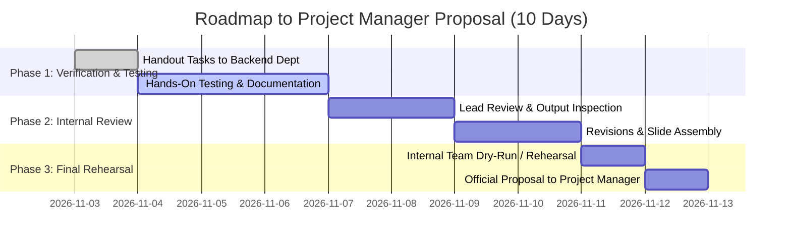

# E-Clearance Backend Team Delegation & PM Handoff Plan

This document details the roles, tasks, deliverables, and presentation structure for presenting and proposing the completed backend system to the **Project Manager (PM)**.

---

## 🎯 Objective: Presenting to the Project Manager (PM)

As the Backend Department, our goal is to propose our completed backend architecture and demonstrate to the Project Manager that:
1. **The system is feature-complete**: Sequential approvals, deficiencies, proof upload, and clearance completion are fully operational.
2. **The infrastructure is production-ready**: Running live on Render with automated health checks, dynamic port binding, and secure cloud MySQL.
3. **The frontend team is unblocked**: API contracts, Postman collections, Swagger documentation, and error specifications are documented for immediate handoff.
4. **Data integrity and recovery are guaranteed**: ERD, data dictionary, and disaster recovery runbooks are in place.

---

## 🏛️ Team Structure & Assigned PM Deliverables

| Group / Role | Headcount | Internal Mission & PM Focus | Key Deliverable |
| :--- | :---: | :--- | :--- |
| **Lead Backend Engineer** | 1 (You) | Architecture Overview, Live Cloud Demo & Official PM Proposal | Working Live Cloud API, Repository Management |
| **Assistant Backend** | 1 | End-to-End QA Testing, Edge-Case Matrix, Master PM Report Consolidation | `docs/QA_TEST_EXECUTION_MATRIX.md` & Master Report Deck |
| **Database Administrators (DBA Team)** | 3 | **Unified Database Package**: Visual ERD Schema, Data Dictionary, Backup & Restore Runbook | `docs/DATABASE_ERD.png`, `docs/DATA_DICTIONARY.md`, `docs/DB_BACKUP_AND_RESTORE_MANUAL.md` |
| **API & Integration Specialists** | 2 | **Unified API & Handoff Package**: Postman Test Suite, Status Code Audit, Frontend Handoff Guide | `docs/E_Clearance_Postman_Collection.json`, `docs/FRONTEND_API_GUIDE.md` |
| **QR Code & Email Automation** | 2 | Smartphone Camera QR Scan Testing & Real Inbox Email Delivery Verification | `docs/QR_VERIFICATION_SPECIFICATION.md`, `docs/EMAIL_NOTIFICATION_MANUAL.md` |

---

## 📋 Group Responsibilities & Deliverables

### 1. Database Administrators (Team of 3) — Bundled
- **Visual Schema & ERD Architecture**: Take the Mermaid ERD and polish it into an academic/presentation visual (`docs/DATABASE_ERD.png`).
- **Data Dictionary & Constraints Review**: Review and format `docs/DATA_DICTIONARY.md` verifying all columns, keys, and cascade behaviors (`PROTECT`, `CASCADE`, `SET_NULL`).
- **Backup & Disaster Recovery Runbook**: Test and document emergency recovery via phpMyAdmin / `mysqldump` and `python manage.py seed_all` (`docs/DB_BACKUP_AND_RESTORE_MANUAL.md`).

### 2. API & Integration Specialists (Team of 2) — Bundled
- **Live Postman Test Suite**: Build and export a complete Postman collection testing all live Render endpoints with auto-saved JWT Bearer tokens and status code verifications (`docs/E_Clearance_Postman_Collection.json`).
- **Frontend Developer Handoff Handbook**: Create `docs/FRONTEND_API_GUIDE.md` detailing Base URLs, authentication headers, `multipart/form-data` uploads, error response payloads, and reviewing Swagger at `/api/docs/swagger/`.

### 3. QR Code & Email Automation Engineers (Team of 2)
- **QR Code Engineer**: Generate clearances, inspect the certificate QR code, test scan using smartphone cameras (iOS/Android), and document verification behavior in `docs/QR_VERIFICATION_SPECIFICATION.md`.
- **Email Automation Engineer**: Trigger real email dispatches (deficiency notice & completion with PDF), check delivery across inboxes, and document in `docs/EMAIL_NOTIFICATION_MANUAL.md`.

### 4. Assistant Backend (1 Member)
- **QA Test Execution Matrix**: Perform end-to-end user flows and compile 20+ test scenarios into `docs/QA_TEST_EXECUTION_MATRIX.md`.
- **Master PM Presentation Support**: Assist the Lead in compiling diagrams, metrics, and screenshots into the master report.

---

## ⏱️ Timeline to PM Presentation (10 Days)

