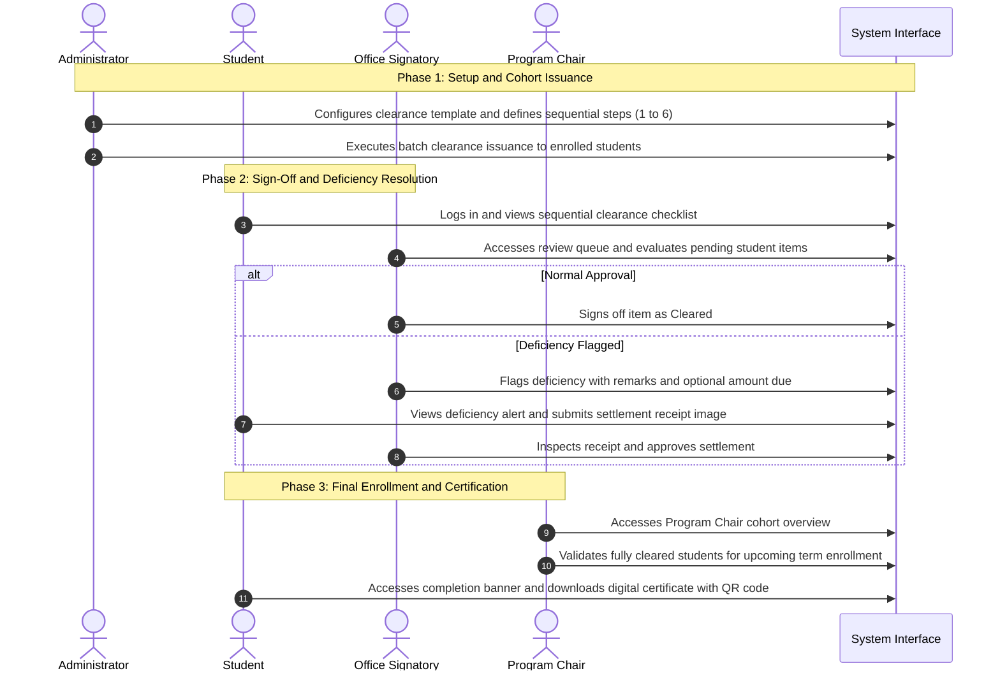

# E-Clearance System: UI/UX Design Specification and Interface Guide

**Document Version:** 1.0  
**Target Audience:** UI/UX Design Team  
**Scope:** Information Architecture, Navigation Hierarchies, Screen Contents, and Workflow States  

---

## 1. System Overview and Portal Architecture

The E-Clearance System digitizes and automates institutional academic clearance routing. The system replaces paper clearance forms with a sequential digital review process, deficiency tracking, proof-of-settlement verification, automated notifications, and cryptographically verifiable PDF certificates.

The user interface is organized into **three primary portals**:

1. **Student Portal:** Enables students to monitor real-time clearance status, review sequential requirements, identify clearance deficiencies, submit receipts or proof documents, and download final clearance certificates.
2. **Signatory Portal:** A unified workspace utilized by all authorizing personnel (Librarians, Cashiers, Advisers, Governors, Deans, and Program Chairs) to evaluate assigned student requirements, issue sign-offs, flag deficiencies with remarks, and verify submitted settlement proofs. The **Program Chair** role receives an extended cohort analytics view and term enrollment validation authority within this portal.
3. **Administration Portal:** Used by system administrators to configure clearance templates, define sequential requirements, batch-issue clearances to student cohorts, manage student rosters, and review audit trails.

---

## 2. End-to-End System Workflow

The diagram below outlines the standard operational progression of the clearance system across all user roles:

---

## 3. Interface Specifications by Portal

---

### 3.1 Student Portal

The Student Portal is optimized for self-service transparency and mobile accessibility.

#### Primary Navigation Menu
* **Clearance Dashboard** (Default landing view)
* **Clearance History** (Archive of past academic terms)
* **Notifications** (Inbox for alerts and deficiency notices)
* **Account Settings** (Profile, security, and contact preferences)

---

#### Screen S-1: Student Clearance Dashboard
* **Purpose:** Serves as the central interface for students to track real-time clearance progression for the active academic term.
* **Header and Status Section:**
  * **Academic Term Indicator:** Displays current term details (e.g., "1st Semester, AY 2026-2027 — Semestral Clearance").
  * **Overall Status Chip:** Color-coded status indicator displaying one of the following states:
    * `Pending` (Neutral/Amber): Clearance initiated, requirements in progress.
    * `Under Review` (Blue): Proof of settlement uploaded, awaiting signatory verification.
    * `Deficiency` (Red): One or more offices have reported an outstanding obligation.
    * `Completed` (Green): All requirements satisfied; certificate generated.
  * **Progress Tracker:** Visual progress bar indicating completion ratio (e.g., "4 of 6 Requirements Cleared — 66%").
* **Main Content Area — Sequential Requirement Checklist:**
  A vertical sequential list containing cards for each of the six clearance requirements:
  1. Library Clearance
  2. Cashier Clearance
  3. Adviser Approval
  4. Program Chair Approval
  5. Institute Governor Clearance
  6. Institute Dean Clearance
* **Individual Requirement Card Elements:**
  * Requirement title and authorizing office.
  * Current status badge (`Pending`, `Under Review`, `Deficiency`, `Cleared`).
  * Sign-off metadata (Signatory name and timestamp upon completion).
  * **Deficiency Callout Box (when status is `Deficiency`):**
    * Prominent alert container displaying the reason (e.g., "Unreturned Book: Database System Concepts 7th Edition").
    * Outstanding balance amount if applicable (e.g., "Amount Due: PHP 150.00").
    * Action button: **Upload Proof of Settlement**.
    * If proof has been submitted: Thumbnail preview of the receipt, submission timestamp, and status updated to `Under Review`.
* **Completion Banner (when status is `Completed`):**
  * Congratulatory banner confirming successful completion of all institutional requirements.
  * Primary action button: **Download Certificate of Clearance (PDF)**.
  * Public QR verification indicator.

---

#### Modal S-2: Settlement Proof Submission Dialog
* **Trigger:** Clicked via the "Upload Proof of Settlement" action on an affected requirement card.
* **Form Elements:**
  * Context header showing the target requirement and office name.
  * **File Upload Dropzone:** Drag-and-drop zone accepting image attachments (JPEG, PNG) and PDF documents up to 5MB. Includes file preview and removal controls.
  * **Remarks Textarea:** Input field for reference numbers or notes (e.g., "GCash Reference Number: 901234567890, Settled at cashier window 2").
* **Dialog Actions:**
  * Secondary button: **Cancel**.
  * Primary button: **Submit Proof**.

---

#### Screen S-3: Public QR Verification Screen
* **Purpose:** Publicly accessible, responsive verification page rendered when an external party scans the QR code located on a student's printed or digital clearance certificate.
* **Layout and Elements:**
  * Institutional seal and official heading.
  * Large verification checkmark icon and "Officially Verified" header.
  * Verification Details Grid:
    * Student Full Name
    * Student ID Number
    * Academic Program and Year Level
    * Clearance Title and Academic Term
    * Date and Time of Final Completion
    * Unique Cryptographic Verification Identifier

---

### 3.2 Clearance Signatory Portal

This portal is used by all authorizing officers: Librarians, Cashiers, Advisers, Governors, Deans, and Program Chairs.

#### Primary Navigation Menu
* **Overview Dashboard** (Workload summary and metric cards)
* **Approval Queue** (Active student list and signing workspace)
* **Deficiencies and Proofs** (Filtered view of items requiring settlement review)
* **Cohort Overview** *(Visible exclusively to users assigned to the `Program Chair` role)*
* **Notifications**

---

#### Screen SIG-1: Signatory Overview Dashboard
* **Purpose:** Delivers high-level operational visibility into the signatory's current workload and pending items.
* **Metric Cards:**
  * **Pending Reviews:** Total students awaiting review at the signatory's stage.
  * **Active Deficiencies:** Total students currently flagged with unpaid obligations or unreturned items.
  * **Pending Settlement Proofs:** Submissions awaiting receipt verification.
  * **Total Approved:** Total student requirements successfully cleared.
* **Activity Stream:** Compact timeline showing recently signed or modified student clearance records.

---

#### Screen SIG-2: Clearance Approval Queue
* **Purpose:** The primary table interface where signatories inspect student clearance records, sign off requirements, and log deficiencies.
* **Filter and Search Controls:**
  * Text search field (filters by student full name or student ID number).
  * Academic program dropdown selector (e.g., All Programs, BSIT, BSIS).
  * Status filter tabs: `All`, `Pending`, `Under Review`, `Deficiency`, `Cleared`.
* **Data Table Columns:**
  * **Student Identifier:** Student ID, Full Name, Year Level, and Section (e.g., "202400633 — Froyd D. Carbajosa — BSIT 3-C").
  * **Requirement:** Name of the specific requirement assigned to the signatory.
  * **Current Status:** Status chip (`Pending`, `Under Review`, `Deficiency`, `Cleared`).
  * **Deficiency Summary:** Displays outstanding balance or brief reason, if applicable.
  * **Attachment Indicator:** Thumbnail icon indicating presence of uploaded proof document.
  * **Row Actions:**
    * **Approve / Clear Button:** Immediately approves the requirement for the student.
    * **Flag Deficiency Button:** Opens the deficiency input modal.
    * **Inspect Proof Button:** Enabled when an item contains an uploaded receipt awaiting verification.

---

#### Modal SIG-3: Flag Deficiency Dialog
* **Trigger:** Clicked via the "Flag Deficiency" action button in the approval queue.
* **Form Elements:**
  * Read-only student summary (Student Name, ID, and Program).
  * **Amount Due Field (Optional):** Numeric currency field for financial liabilities (e.g., lost book cost, laboratory fee).
  * **Reason / Remarks Field (Required):** Textarea detailing the exact cause of deficiency (e.g., "Overdue library book: 'Operating System Concepts'").
  * Notice box: Informs the signatory that an automated notification will be dispatched to the student upon submission.
* **Dialog Actions:**
  * Secondary button: **Cancel**.
  * Primary button: **Confirm Deficiency**.

---

#### Modal SIG-4: Settlement Proof Review Dialog
* **Trigger:** Clicked via the "Inspect Proof" action button on an item marked `Under Review`.
* **Modal Elements:**
  * High-resolution document viewer displaying the uploaded receipt or document.
  * Student submission notes and timestamp.
  * Deficiency reference (original amount due and initial remarks).
* **Dialog Actions:**
  * Destructive action: **Reject Proof** (Prompts for rejection reason and keeps deficiency active).
  * Primary action: **Approve and Clear** (Validates settlement, records sign-off, and marks requirement as cleared).

---

#### Screen SIG-5: Program Chair Cohort Dashboard (Program Chair Extension)
* **Access Scope:** Rendered exclusively for users possessing the `Program Chair` role.
* **Purpose:** Provides cohort-wide clearance tracking across all six requirements for students enrolled under the chair's department.
* **Summary Analytics Cards:**
  * Total Department Students (e.g., "BSIT: 120 Students Enrolled").
  * Cohort Clearance Completion Rate (Percentage of students with all 6 steps cleared).
  * Term Enrollment Progress (Total students validated for next term enrollment).
* **Department Student Roster Table:**
  * Student ID and Name.
  * Multi-step progress indicator showing status of all 6 steps.
  * Overall clearance status badge.
  * **Enrollment Validation Action:**
    * When all 6 steps are cleared, a dedicated action button is enabled: **Validate for Enrollment**.
    * Clicking this action officially registers the student as eligible and enrolled for the subsequent term.

---

### 3.3 Clearance Administration Portal

The Administration Portal provides institutional oversight, clearance lifecycle management, and auditing capabilities.

#### Primary Navigation Menu
* **Executive Dashboard** (Campus-wide analytics and bottleneck tracking)
* **Clearance Templates** (Template builder and requirement sequencing)
* **Student Directory** (Student account management and bulk import)
* **Signatory Roles** (Staff assignment to clearance roles)
* **Audit Logs** (Compliance monitoring and report exports)

---

#### Screen A-1: Executive Analytics Dashboard
* **Purpose:** Delivers high-level operational metrics across all institutional departments.
* **Visual Components:**
  * Active Term Summary: Active clearance name, target academic year, and semester.
  * Clearance Status Distribution Chart: Donut/pie chart illustrating campus-wide completion proportions.
  * Office Bottleneck Analysis Chart: Bar chart identifying offices with the highest volume of unresolved or pending clearance items (e.g., Library vs. Cashier vs. Dean).

---

#### Screen A-2: Clearance Template and Sequencer Management
* **Purpose:** Allows administrators to establish clearance criteria and define the sequential approval chain prior to issuance.
* **Layout and Sections:**
  * **Template Configuration Card:**
    * Clearance Title (e.g., "Semestral Clearance").
    * Academic Year and Semester selectors.
    * Target Student Year Levels (Checkboxes: 1st Year, 2nd Year, 3rd Year, 4th Year).
  * **Sequential Requirement Builder:**
    * Numbered step list enforcing sequential order:
      * Step 1: Library Clearance (Authorizing Role: `Librarians`)
      * Step 2: Cashier Clearance (Authorizing Role: `Cashiers`)
      * Step 3: Adviser Approval (Authorizing Role: `Advisers`)
      * Step 4: Program Chair Approval (Authorizing Role: `Program Chairs`)
      * Step 5: Governor Clearance (Authorizing Role: `Governors`)
      * Step 6: Dean Clearance (Authorizing Role: `Deans`)
  * **Issuance Action Control:**
    * Primary button: **Issue Clearance to Students**.
    * Confirmation modal prompting the administrator to confirm batch generation of clearance records for all eligible students.

---

#### Screen A-3: Student Directory and Bulk Import
* **Purpose:** Provides tools to view student rosters and onboard student cohorts via spreadsheet upload.
* **Components:**
  * Searchable and filterable student roster table (Student ID, Name, Program, Year, Section, Enrollment Status).
  * Action button: **Import Students (Excel/CSV)**.
  * **Bulk Import Modal:**
    * File uploader supporting `.xlsx` and `.csv` formats.
    * Download link for standard template spreadsheet.
    * Post-upload error/success summary dialog.

---

#### Screen A-4: Audit Logs and Report Generation
* **Purpose:** Maintains a tamper-evident administrative log of all critical transactions within the system.
* **Interface Elements:**
  * Filterable log table displaying: Timestamp, Actor, Office Role, Action Type (`Signed`, `Flagged Deficiency`, `Proof Approved`, `Template Issued`), Target Student, and System Notes.
  * Header Export Controls:
    * **Export PDF Summary**
    * **Export Spreadsheet (Excel)**

---

## 4. Common Interfaces and System-Wide Components

The following interfaces are shared across all user roles:

### 4.1 Authentication Screens
* **Login Screen:** User identifier field (Student ID or Employee Username), Password input with visibility toggle, "Remember Me" checkbox, and Submit button. Link to Password Recovery.
* **Password Recovery Flow (Three-Step Process):**
  1. *Step 1 (Identifier Submission):* User enters registered email address.
  2. *Step 2 (OTP Verification):* User inputs 6-digit numeric verification code received via email.
  3. *Step 3 (Password Reset):* User inputs and confirms new secure password.

### 4.2 Application Header and Notification Flyout
* **Global Header:**
  * Institutional Branding: Official institution and campus name.
  * Active Role Chip: Indicates active user persona and office.
  * Notification Bell: Unread badge counter showing pending notifications.
  * User Menu Dropdown: Displays user avatar, name, profile navigation link, and Logout action.
* **Notification Drawer:**
  * Slide-out panel displaying chronological alerts (deficiency alerts, proof submissions, approval updates).
  * Action control: "Mark All as Read".

---

## 5. Critical System Behaviors for UI Design

To maintain consistency with the system's operational logic, the design team must account for the following three rules:

1. **Sequential Approval Enforcement:**
   * Clearance requirements must be cleared in strict numerical order (Step 1 through Step 6).
   * In both the Student Checklist and the Signatory Queue, actions on subsequent steps must appear disabled if preceding steps remain incomplete.
   * Provide an informative tooltip on disabled approval buttons (e.g., *"Cannot approve: Awaiting Library Clearance sign-off"*).

2. **Offline Payment and Settlement Workflow:**
   * The platform does not incorporate a live third-party payment gateway.
   * Financial or item settlement operates through an offline proof-of-settlement mechanism: students settle requirements externally (counter payment or bank/wallet transfer) and submit receipt images through the interface for manual signatory inspection.

3. **Multi-Tenant Context:**
   * User access is bounded by their respective Institute (e.g., Institute of Computing). Signatories only view students within their authorized organizational scope. The active institute title should be clearly visible in the system navigation header.

---

## 6. Figma Design Matrix and Deliverables Checklist

The UI/UX design team should use the following table to track interface completion in Figma:

| Portal | Screen / Modal ID | Frame Title | Key States to Account For |
| :--- | :--- | :--- | :--- |
| **Student** | `S-1` | Clearance Dashboard | In Progress, With Deficiency, Completed, Empty (No Active Term) |
| **Student** | `S-2` | Proof Submission Dialog | Default, File Drag Over, Uploading, Validation Error |
| **Student** | `S-3` | Public QR Verification | Verified Record, Invalid/Expired Token |
| **Signatory** | `SIG-1` | Signatory Overview | Standard Data, Zero Workload (Empty State) |
| **Signatory** | `SIG-2` | Approval Queue | Filtered Results, Empty Results, Row Hover |
| **Signatory** | `SIG-3` | Flag Deficiency Dialog | Initial Input, Form Validation Error |
| **Signatory** | `SIG-4` | Settlement Review Dialog | Full-Size Image Preview, Rejection Input State |
| **Signatory** | `SIG-5` | Program Chair Dashboard | Cohort Progress View, Enrollment Button Enabled/Disabled |
| **Admin** | `A-1` | Analytics Dashboard | Standard Analytics View, Date Filtered |
| **Admin** | `A-2` | Template Sequencer | Sequence Reordering, Confirmation State |
| **Admin** | `A-3` | Student Directory | Standard Table, Upload Modal, Import Error Summary |
| **Admin** | `A-4` | Audit Logs | Filtered View, Export in Progress |
| **Shared** | `AUTH-1` | Login Screen | Default, Loading State, Invalid Credentials Error |
| **Shared** | `AUTH-2` | Password Reset (3 Steps) | Email Entry, OTP Code Entry, New Password Entry |
| **Shared** | `COMMON-1`| Notification Drawer | Unread Items, Empty State |
