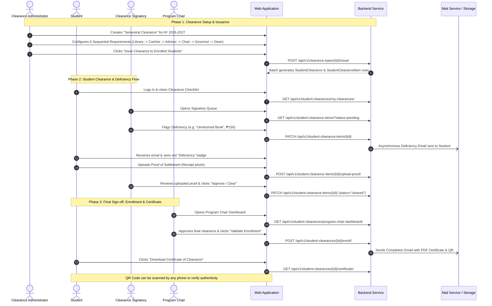

# System Blueprint & UI/UX Design Specification: E-Clearance System

This document is the official **System Architecture & UI/UX Design Blueprint** for the E-Clearance System. It bridges the **actual backend API implementation** with the design requirements for the **UI/UX Designers (Figma)** and **Frontend Developers (React / Vue / Vite)**.

---

## 1. Executive Summary and System Roles

The E-Clearance System is an academic clearance automation platform that eliminates physical paper clearance routing. It features sequential approvals, deficiency flagging, proof-of-settlement uploads, automated email notifications, digital PDF certificate generation, and QR code verification.

Based on the actual codebase (`api/rbac/roles.py`, `api/clearance/views.py`, `api/urls.py`), the system has **3 Core Portals / User Archetypes** (with the **Program Chair** operating as a **Signatory with Extended Features**):

1. **Student** (`Roles.STUDENT`): Views clearance status, requirement checklist, tracks deficiencies, uploads proof receipts, downloads certificate.
2. **Clearance Signatory** (`Librarians`, `Deans`, `Cashiers`, `Advisers`, `Governors`, `Program Chairs`):
   - **Standard Signatories**: Review assigned student items, sign off approvals, flag deficiencies with amounts/remarks, review submitted payment proofs.
   - **Program Chair (Extended Signatory / "Signatory+")**: Performs standard signatory sign-offs for the department step PLUS accesses cohort analytics (`program-chair-dashboard`) and validates students for term enrollment (`is_enrolled`).
3. **Clearance Admin / School Admin** (`Roles.CLEARANCE_ADMIN`, `Roles.SCHOOL_ADMIN`, `Roles.INSTITUTE_ADMIN`, `Superuser`): Creates clearance templates, sets up requirement steps, batch-issues clearance to students, monitors institute-wide clearance metrics, and manages system settings/audits.

---

## 2. Complete System Workflow

---

## 3. Detailed UI Specification by Role

---

### Persona 1: Student Portal

#### Primary Nav / Sidebar:
1. **My Clearance** (Home / Primary Screen)
2. **Clearance History** (Past semesters / terms)
3. **Notifications** (Inbox for alerts)
4. **My Profile & Security** (Avatar, Password, Email change)

---

#### Screen 1.1: Student Clearance Dashboard (`/student/clearance`)
* **Purpose**: Primary hub showing current clearance progress, deficiencies, and quick actions.
* **Header / Stat Cards**:
  - **Overall Status Badge**: `PENDING` (Yellow), `UNDER REVIEW` (Blue), `DEFICIENT` (Red), `CLEARED` (Green), `COMPLETED` (Purple).
  - **Progress Bar**: e.g., *"4 of 6 Requirements Cleared (66%)"*.
  - **Academic Term Info**: e.g., *"1st Semester, AY 2026-2027 - Semestral Clearance"*.
* **Main Section - Sequential Clearance Checklist**:
  - A vertical step-card / stepper list showing the 6 requirements in order (`order_sequence`):
    1. Library Clearance
    2. Cashier Clearance
    3. Adviser Approval
    4. Program Chair Approval
    5. Governor Approval
    6. Dean Approval
  - **Each Step Card Displays**:
    - Requirement Name & Authorizing Office
    - Status Chip (`Pending`, `Cleared`, `Deficiency`, `Under Review`)
    - Signatory details (Signed by *Mr. Librarian* on *Nov 4, 2026, 2:30 PM*)
    - If **Deficiency**:
      - Red warning box with `remarks` ("Unreturned Book: Database Systems")
      - Amount due (`amount_due` e.g. "₱150.00")
      - If proof uploaded: Preview thumbnail of receipt + `proof_notes`
      - **Action Button**: *"Upload Proof of Settlement"* (opens Modal) or *"Remove Proof"*
* **Bottom / Sticky Action**:
  - If status == `COMPLETED`: Huge Banner: *"Congratulations! You are officially cleared."* + Button: **"Download PDF Certificate"** (with QR icon).
* **Supporting Endpoints**:
  - `GET /api/v1/student-clearances/my-clearances/`
  - `POST /api/v1/student-clearance-items/{id}/upload-proof/` (multipart file + text)
  - `DELETE /api/v1/student-clearance-items/{id}/remove-proof/`
  - `GET /api/v1/student-clearances/{id}/certificate/` (Streams PDF)

---

#### Screen 1.2: Upload Proof Modal (`Dialog / Modal`)
* **Purpose**: Allows student to submit payment receipts or return slips.
* **Fields**:
  - File Dropzone (`proof_attachment`): accepts JPG, PNG, PDF up to 5MB.
  - Textarea (`proof_notes`): *"e.g., Paid via GCash Ref #123456 or Handed over to Asst. Librarian"*.
* **Buttons**: `Cancel`, `Submit Proof`.

---

#### Screen 1.3: Certificate & Public QR Verification (`/verify/{uuid}`)
* **Purpose**: Public-facing read-only screen opened when anyone scans the QR code on the certificate.
* **Displays**:
  - College Seal & DNSC Header
  - Valid Certificate Verification Stamp (Green Checkmark)
  - Student Name, Student ID, Program (BSIT)
  - Clearance Title (Semestral Clearance AY 2026-2027)
  - Date Completed & Cryptographic Verification Token
* **Supporting Endpoint**:
  - `GET /api/v1/student-clearances/verify/{verification_token}/` (Public, no auth needed).

---

### Persona 2: Clearance Signatory Portal (Unified for All Signatories)

This portal serves **all clearance signatories** (`Librarians`, `Deans`, `Cashiers`, `Advisers`, `Governors`, and `Program Chairs`). They share the same core UI layout and sign-off tools, while the **Program Chair** receives an additional cohort analytics tab and enrollment validation powers.

#### Primary Nav / Sidebar:
1. **Signatory Dashboard** (Overview & metric counters)
2. **Clearance Approval Queue** (Student list / signing table)
3. **Deficiency & Proof Review** (Items awaiting proof validation)
4. **Cohort Enrollment** *(Visible only to `Roles.PROGRAM_CHAIR`)*
5. **Notifications**

---

#### Screen 2.1: Signatory Dashboard (`/signatory/dashboard`)
* **Purpose**: High-level overview of incoming clearance workloads.
* **Stat Cards (All Signatories)**:
  - Total Students Assigned
  - Pending Review (`pending`)
  - Items with Deficiencies (`deficiency`)
  - Awaiting Proof Verification (`under_review`)
  - Cleared Students (`cleared`)
* **Supporting Endpoint**:
  - `GET /api/v1/student-clearance-items/signatory-dashboard/`

---

#### Screen 2.2: Clearance Review Queue (`/signatory/queue`)
* **Purpose**: Table where signatories review and sign student items for their assigned office.
* **Filters & Search**:
  - Search by Student Name or Student ID (`s_studentID`)
  - Filter by Program (BSIT, BSIS)
  - Filter by Status (`pending`, `deficiency`, `under_review`, `cleared`)
  - Filter by Year Level (1, 2, 3, 4) or Section (Set C)
* **Data Table Columns**:
  - `Student ID` & `Student Full Name`
  - `Program` & `Year / Section`
  - `Requirement`
  - `Status` (Chip)
  - `Remarks / Amount Due`
  - `Proof Attachment` (Thumbnail icon if uploaded)
  - `Actions`:
    - **Clear / Approve Button** (Green)
    - **Flag Deficiency Button** (Orange / Red)
    - **View Details / Proof Button**
* **Modals**:
  - **Flag Deficiency Modal**:
    - Input: `amount_due` (optional decimal)
    - Input: `remarks` (required explanation: e.g. "Missing laboratory equipment")
    - Submit -> Sets item to `deficiency` and triggers student email.
  - **Review Proof Modal**:
    - Displays full-size receipt image from Cloudinary
    - Displays student notes
    - Actions: `Approve Settlement` (clears item) or `Reject Proof` (retains deficiency with new remarks).
* **Supporting Endpoints**:
  - `GET /api/v1/student-clearance-items/` (supports `?status=`, `?student_id=`, `?search=`)
  - `PATCH /api/v1/student-clearance-items/{id}/` (`{"status": "cleared"}`)
  - `PATCH /api/v1/student-clearance-items/{id}/` (`{"status": "deficiency", "remarks": "...", "amount_due": 150}`)

---

#### Screen 2.3: Program Chair Extended Features ("Signatory+" Superpowers)
*When the logged-in user holds `Roles.PROGRAM_CHAIR`, the UI unlocks two specialized capabilities:*

1. **Program Chair Cohort Dashboard** (`/signatory/cohort-dashboard`):
   - **Purpose**: High-level view of the entire student body within the Program Chair's department (e.g., BSIT).
   - **Analytics Cards**:
     - Total Department Students (e.g. BSIT: 120 Students)
     - Overall Clearance Completion Rate (% Fully Cleared across all offices)
     - Total Validated for Next Term Enrollment (`is_enrolled == True`)
     - Pending Enrollment Validation
   - **Supporting Endpoint**:
     - `GET /api/v1/student-clearances/program-chair-dashboard/`

2. **Enrollment Validation Action**:
   - In the student list or clearance detail view, Program Chairs see a prominent **"Validate for Enrollment"** button for students who have successfully completed all clearance requirements.
   - **Action**: Clicking **"Validate for Enrollment"** marks `is_enrolled=True` and records the Program Chair as `enrolled_by_user`.
   - **Supporting Endpoint**:
     - `POST /api/v1/student-clearances/{id}/enroll/`

---

### Persona 3: Clearance Administrator Portal

#### Primary Nav / Sidebar:
1. **Admin Analytics Dashboard** (College-wide clearance metrics)
2. **Clearance Management** (Templates & Requirements builder)
3. **Student Directory & Bulk Import** (Student accounts & enrollment)
4. **Signatory Roles & Assignments** (Assigning staff to clearance roles)
5. **System Settings & Academic Term** (AY, Semester, toggles)
6. **Audit Logs & Reports** (Security trail & Excel/PDF export)

---

#### Screen 4.1: Clearance Admin Analytics Dashboard (`/admin/dashboard`)
* **Stat Cards**:
  - Active Clearance Title & Academic Year (e.g. "Semestral Clearance 2026-2027")
  - Total Eligible Students
  - Overall Completion %
  - Deficiencies Outstanding (₱ Total Unpaid Dues across campus)
* **Breakdown Visuals**:
  - Chart: Clearances by Status (Pie / Donut: `Pending`, `Under Review`, `Cleared`, `Completed`).
  - Table: Bottleneck Requirements (Which office has the most pending items? e.g. Library: 45 pending, Dean: 10 pending).
* **Supporting Endpoints**:
  - `GET /api/v1/clearance-types/admin-summary/`
  - `GET /api/v1/clearance-types/{id}/dashboard/`

---

#### Screen 4.2: Clearance Templates & Requirements Builder (`/admin/clearance-types`)
* **Purpose**: Create and manage clearance templates and their sequential requirements.
* **Views**:
  - **Template List**: Shows current templates, academic year, semester, active status, and `is_issued` flag.
  - **Create Template Modal**:
    - Name: "Semestral Clearance"
    - Category: `semestral` / `graduation` / `transfer`
    - Academic Year: "2026-2027"
    - Semester: "1st Semester"
    - Target Year Levels: Checkboxes [1, 2, 3, 4]
  - **Requirement Builder (Step Builder)**:
    - Drag-and-drop or numbered sequence list:
      - Step 1: Library Clearance -> Authorizing Role: `Librarians`
      - Step 2: Cashier Clearance -> Authorizing Role: `Cashiers`
      - Step 3: Adviser Approval -> Authorizing Role: `Advisers`
      - Step 4: Program Chair Approval -> Authorizing Role: `Program Chairs`
      - Step 5: Governor Approval -> Authorizing Role: `Governors`
      - Step 6: Dean Approval -> Authorizing Role: `Deans`
  - **Critical Action Button**:
    - **"Issue Clearance to Students"** (Triggers batch creation of clearances for all target students).
* **Supporting Endpoints**:
  - `GET /api/v1/clearance-types/`
  - `POST /api/v1/clearance-types/`
  - `POST /api/v1/clearance-requirements/`
  - `POST /api/v1/clearance-types/{id}/issue/`

---

#### Screen 4.3: Student Directory & Bulk Excel Import (`/admin/students`)
* **Purpose**: Manage student profiles and onboard student cohorts.
* **Features**:
  - Searchable table: Student ID, Full Name, Program, Year Level, Section, Status.
  - **"Import Students via Excel / CSV"** Button:
    - Opens upload modal with file dropzone.
    - Button to download sample template (`GET /api/v1/admin/student-bulk-invitations/template/`).
    - Upload endpoint: `POST /api/v1/admin/student-bulk-invitations/upload/`.
* **Supporting Endpoints**:
  - `GET /api/v1/students/`
  - `POST /api/v1/admin/student-bulk-invitations/`

---

#### Screen 4.4: Signatory Role Management (`/admin/roles`)
* **Purpose**: Assign which staff members hold signatory titles (Dean, Librarian, Cashier).
* **UI**:
  - Role list cards (`Librarians`, `Deans`, `Cashiers`, etc.) with user count chips.
  - Clicking a role shows assigned users with "Add Staff" modal.
* **Supporting Endpoints**:
  - `GET /api/v1/clearance-roles/`
  - `POST /api/v1/access/assign/`

---

#### Screen 4.5: Audit Logs & Report Exports (`/admin/audits`)
* **Purpose**: Compliance and activity tracking.
* **UI**:
  - Filterable audit trail table: Timestamp, Actor, Action (`CREATE`, `UPDATE`, `SIGN`), Entity, Old Value vs New Value.
  - Buttons: **Export PDF Report** (`/api/v1/audit-logs/report/pdf/`) and **Export Excel Report** (`/api/v1/audit-logs/report/excel/`).
* **Supporting Endpoints**:
  - `GET /api/v1/audit-logs/`
  - `GET /api/v1/audit-logs/report/excel/`
  - `GET /api/v1/audit-logs/report/pdf/`

---

## 4. Common Screens and Interface Patterns

### 1. Authentication Screens
* **Login Screen** (`/login`):
  - Username or Student ID input.
  - Password input (with show/hide eye toggle).
  - "Sign In" button (`POST /api/v1/login/`).
  - Google Sign-In button (`POST /api/v1/auth/google/`).
  - "Forgot Password?" link (`/password-reset`).
* **Password Reset Flow**:
  1. Request OTP email (`POST /api/v1/password-reset/request/`).
  2. Enter 6-digit OTP code (`POST /api/v1/password-reset/verify/`).
  3. Enter new password (`POST /api/v1/password-reset/change/`).

### 2. Header & Notification Bell
* **Notification Dropdown**:
  - Bell icon with unread badge counter (`GET /api/v1/notifications/unread-count/`).
  - Dropdown list of alerts (Deficiency alerts, approval notices).
  - Clicking notification marks it as read (`GET /api/v1/notifications/{id}/`).
  - "Mark All as Read" button (`POST /api/v1/notifications/mark-all-read/`).
* **User Profile Menu**:
  - Avatar, Name, Role badge (`GET /api/v1/me/`).
  - Profile Settings: Update avatar image (`PATCH /api/v1/me/update/` via Cloudinary).
  - Change Email self-service (`/api/v1/email-change/request/`).
  - Logout (`POST /api/v1/logout/`).

---

## 5. UI/UX Designer Checklist for Figma

| Role | Screen Name | Key Components to Design | Supported State Variants |
| :--- | :--- | :--- | :--- |
| **Public / Auth** | Login Screen | Logo, DNSC branding, Username/Password inputs, Google button, Forgot password link | Normal, Loading, Error (invalid creds) |
| **Public / Auth** | Forgot Password (3 Steps) | 1. Email input, 2. OTP 6-box input, 3. New password input | Normal, Timer countdown, Expired code |
| **Public / Auth** | QR Public Verification Page | University seal, Verified badge, Student details, Token display | Verified (Green), Invalid/Tampered (Red) |
| **Student** | Clearance Dashboard (Home) | Progress bar, Term header, 6 sequential requirement cards, Status badges | Empty (no active clearance), In Progress, Deficient, Completed |
| **Student** | Upload Proof Modal | File drag-and-drop dropzone, Note input, Submit & Cancel buttons | Default, Uploading progress bar, Success |
| **Student** | Certificate View / Modal | PDF preview canvas, Download PDF button, QR code badge | Loading PDF stream, Rendered |
| **Signatory** | Signatory Dashboard | 5 Stat metric cards, Recent activity feed, Pending reviews table | Normal, Zero pending items (Empty state) |
| **Signatory** | Clearance Approval Queue | Search bar, Program filter, Multi-column student table, Clear/Deficiency buttons | Normal, Filtered results, Empty results |
| **Signatory** | Flag Deficiency Modal | Remarks textarea, Amount due currency input, Submit warning | Default, Validation error |
| **Signatory** | Proof Review Modal | Large preview of receipt, Student notes box, Approve/Reject buttons | Image loading, Fullscreen preview |
| **Signatory (Chair Extension)** | Program Chair Cohort Dashboard | Cohort completion pie chart, Enrolled count, Student table with "Enroll" action | Normal, Filtered by Year/Set |
| **Admin** | Admin Analytics Dashboard | Overall completion rate, Deficiencies total (₱), Bottleneck office chart | Normal data, Date range filtered |
| **Admin** | Clearance Template Builder | Template card list, Multi-step requirement sequencer, "Issue to Students" button | Draft, Published/Issued (Locked) |
| **Admin** | Student Masterlist & Import | Student table, Pagination, "Import Excel" button, File upload dropzone | Normal, Upload processing, Error report |
| **Admin** | Signatory Role Assignment | Role category cards (Dean, Librarian, etc.), User assignment drawer | Normal, Empty role |
| **Admin** | Audit Logs & Export | Filterable security table, Date picker, Export to Excel/PDF buttons | Loading, Paginated |
| **All Users** | Notification Flyout Drawer | List of alerts with timestamps, "Mark all read" link, Empty notification illustration | Unread state, Read state, Empty state |
| **All Users** | Profile & Avatar Settings | Avatar photo uploader, Personal info card, Security tab | Cropping preview, Saving |

---

## 6. Implementation Notes and Business Rules

1. **No In-App Payment Gateway**:
   - The backend supports tracking `amount_due` (e.g. ₱150 for lost book), but it does **not** process live credit card/GCash payments via API.
   - *Design Implication*: The UI should present settlement as an **offline / proof upload flow** (students pay over-the-counter or via personal GCash QR and upload the receipt image for the signatory to verify).
2. **Sequential Requirement Enforcement**:
   - The backend validates sequential signing (`validate_sequential_clearance`). If Requirement #1 (Library) is pending, Requirement #2 (Cashier) cannot be signed yet.
   - *Design Implication*: In the Signatory queue, if a student hasn't cleared previous steps, the action button should be disabled with a tooltip: *"Waiting for previous signatory: Library"*.
3. **Multi-Tenant Isolation**:
   - Staff and students are scoped to their respective institute (`Institute of Computing`). A signatory in IC cannot see students in IAAS.
   - *Design Implication*: The UI should display the active Institute and School name in the top navigation bar so users have clear context of their tenancy.

---

## 7. Recommended Next Steps

1. Export this document and share it with your **UI/UX Designers** as the master specification for Figma.
2. Direct the **Frontend Developers** to use the endpoints documented under each screen.
3. Have the designers focus first on **Student Clearance Dashboard** and **Signatory Approval Queue**, as these represent 80% of daily user interaction.
