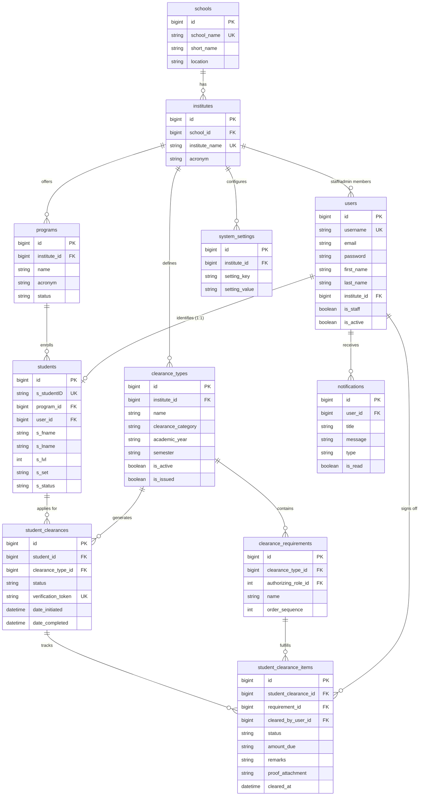

# E-Clearance System API - Clean ERD Specification

This ERD code is stripped of all quote descriptions and "others" comments.
Every attribute follows the clean 3-part structure:
```text
datatype field [KEY]
```
When imported into **Lucidchart** or **Mermaid Live**, it automatically renders as a clean 3-column table:
**`Keys` | `Fields` | `Datatypes`** (or `Datatypes | Fields | Keys`).

---

## 🛠️ Instructions for Lucidchart & Mermaid Live

1. Copy the code block below.
2. In **Lucidchart**: Go to `Insert` -> `Import Data` -> `Mermaid` -> Paste -> Click **Insert Diagram**.
3. In **[Mermaid Live Editor](https://mermaid.live)**: Paste directly.

---

## 📊 Clean 3-Column Mermaid Code


