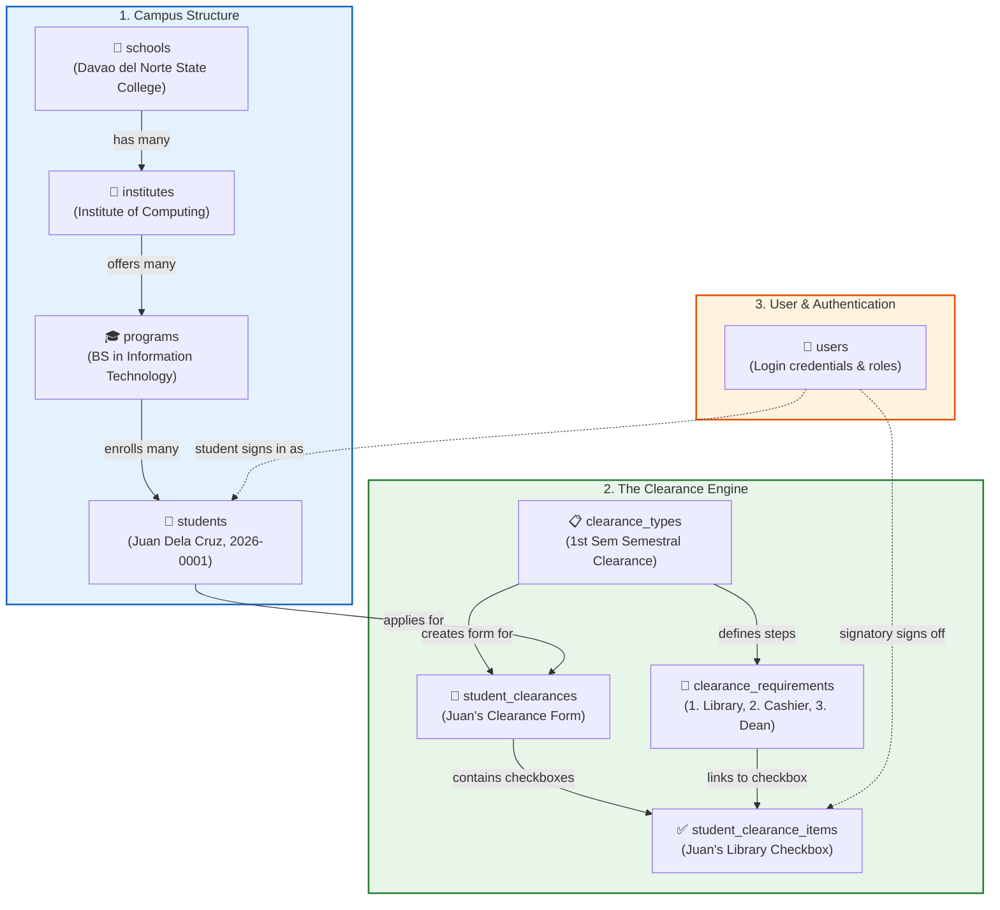
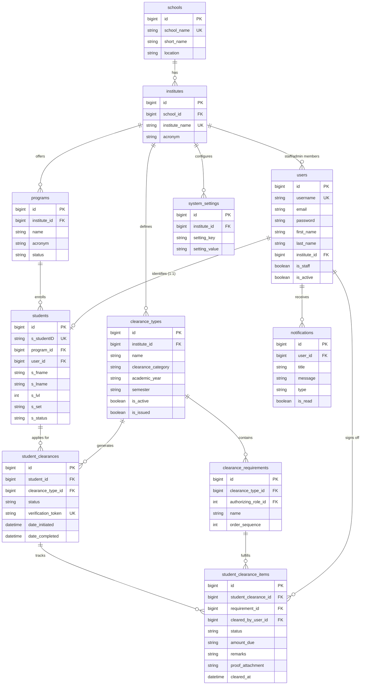

# E-Clearance Database Architecture - Simplified DBA Guide

Welcome DBAs! This guide breaks down the database into simple, visual, real-world concepts so you can easily understand and explain all the table links to anyone.

---

## 💡 The 30-Second Big Picture

The entire database is made of just **3 simple stories**:
1. **The Campus Structure**: Where does the student study? (`School` ➡️ `Institute` ➡️ `Program` ➡️ `Student`)
2. **The Clearance Engine**: How does a student get cleared? (`ClearanceType` ➡️ `StudentClearance` ➡️ `StudentClearanceItems`)
3. **The User & Security System**: Who signs in and who approves? (`User` links to `Student` and signs `Items`)

---

## 🧩 Story 1: The Campus Hierarchy (Parent ➡️ Child)
Think of a Russian nesting doll or an organizational chart:
- **`schools`** (e.g., DNSC)
  - └── **`institutes`** (e.g., Institute of Computing)
        - └── **`programs`** (e.g., BS Information Technology)
              - └── **`students`** (e.g., Juan Dela Cruz)

> **DBA Rule**: Every step cascades down (`on_delete=CASCADE`). If a program is deleted, its students belong to that program.

---

## 📋 Story 2: The Clearance Engine (The Core Feature!)

This is the most important part of the project. Here is how the tables interact in real life:

1. **`clearance_types` (The Template)**:
   - The school creates a template: *"1st Semester 2026-2027 Clearance"*.
2. **`clearance_requirements` (The Steps on the Template)**:
   - What must be cleared? 
     - Step 1: Library (Role: Librarian)
     - Step 2: Clinic (Role: Nurse)
     - Step 3: Cashier (Role: Cashier)
     - Step 4: Dean (Role: Dean)
3. **`student_clearances` (The Student's Paper Form)**:
   - When Juan applies, the system creates **1 `student_clearances` row** for Juan.
   - It gets a unique `verification_token` (UUID) that gets printed as a **QR code** on Juan's final PDF certificate!
4. **`student_clearance_items` (The Checkboxes on the Form)**:
   - If there are 4 requirements, Juan gets **4 `student_clearance_items` rows**:
     - Row 1: Library (Status: Pending or Cleared)
     - Row 2: Clinic (Status: Cleared)
     - Row 3: Cashier (Status: Deficiency -> Amount Due: 150.00 -> Proof Uploaded)
     - Row 4: Dean (Status: Pending)

---

## 🔑 Story 3: Who is `users`?
`users` is the table where usernames and passwords live:
- When a **student** logs in, their `users` row links 1-to-1 to their `students` row.
- When a **signatory** (e.g. Librarian) logs in, they look at Juan's `student_clearance_items` and sign it (`cleared_by_user_id`).

---

## 📊 Clean 3-Column Mermaid Code (Lucidchart Compatible)

Structure: `datatype field [KEY]` (No quote clutter or extra descriptions).

---

## 🎯 Cheat Sheet for DBAs (Questions You Can Answer)

1. **"How does the system know what requirements a student must clear?"**
   > *Answer*: `clearance_types` holds the template (e.g. 1st Sem), which has multiple `clearance_requirements` (Library, Cashier, Dean). When a student initiates clearance, the system generates a `student_clearance_items` row for every requirement.

2. **"How does the QR Code connect to the database?"**
   > *Answer*: The `student_clearances` table has a `verification_token` column (UUID). When the student clears everything, that token is turned into a QR code on their PDF. Scanning the QR code looks up that token in `student_clearances`.

3. **"What happens if a student has an unreturned library book?"**
   > *Answer*: The Librarian updates Juan's row in `student_clearance_items` to `status = 'deficiency'` with `remarks = 'Unreturned book'`. Juan uploads a photo of his return receipt (`proof_attachment`), and the Librarian changes it to `status = 'cleared'`.
