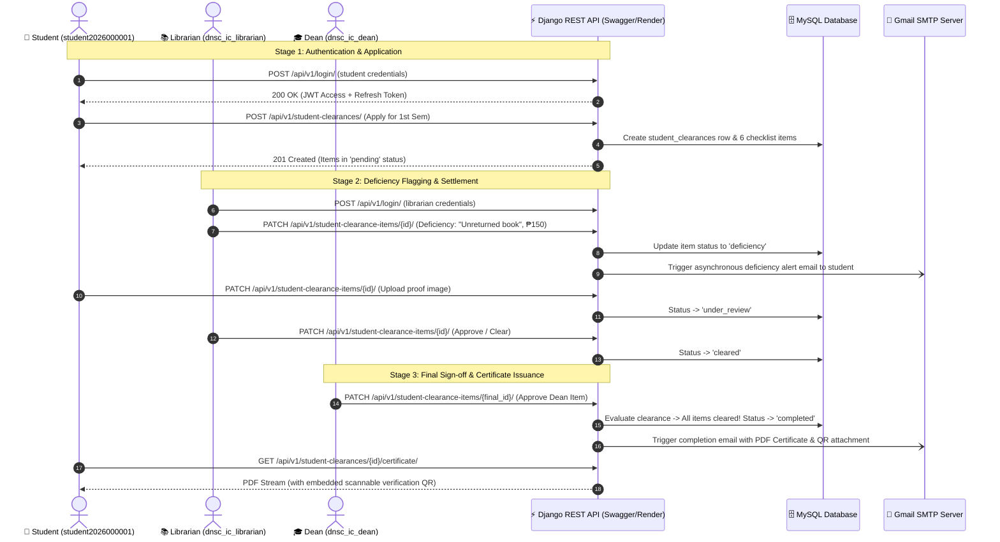

# Implementation Plan: End-to-End Backend Live Demo Walkthrough

This plan provides a structured, live demonstration script you can follow to walk your entire backend department (Assistant Backend, DBAs, QR/Email Engineers, and API Specialists) through the system from start to finish.

---

## 🎯 Demo Goal
By the end of this 30-minute walkthrough, every team member will understand:
1. **The Big Picture**: How their individual deliverable connects to the live production API.
2. **The Clearance Lifecycle**: Exactly what happens when a student applies, gets flagged with a deficiency, settles it, and earns a QR-verified certificate.
3. **The Multi-Tenant & RBAC Mechanics**: How roles (`Librarian`, `Dean`, `Cashier`, `Student`) interact without crossing institute boundaries.

---

## 👥 Attendees & Their Learning Focus

| Role | What They Must Observe During the Demo |
| :--- | :--- |
| **Database Administrators (3)** | How SQL rows transition across `clearance_types` ➡️ `student_clearances` ➡️ `student_clearance_items`. |
| **QR Code & Email Automation (2)** | How `verification_token` embeds into the PDF QR code and how deficiency/completion emails are triggered. |
| **API & Integration Specialists (2)** | Request/response JSON structures, Bearer Token headers, Swagger UI, and `multipart/form-data` uploads. |
| **Assistant Backend (1)** | The complete user journey flow to validate against their 20+ scenario QA matrix. |

---

## 🗺️ Live Demo Flow Overview



---

## 🎬 Step-by-Step Live Demo Script

### Preparation (2 Minutes Before Meeting)
1. Open your browser to the **Swagger UI**:
   - Production: `https://e-clearance-system-api.onrender.com/api/docs/swagger/`
   - (Or Local): `http://127.0.0.1:8000/api/docs/swagger/`
2. Keep the **Database GUI** (phpMyAdmin / DBeaver) or terminal open to show table rows changing in real time.
3. Have your smartphone camera ready for the live QR scan.

---

### Act 1: Orientation & Architecture (3 Minutes)
* **What you say to the team**:
  > *"Team, before we test endpoints, notice our Swagger UI is grouped into clean functional tags: `Auth`, `Clearance`, `Students`, `Users`, and `Notifications`. Every request requires an `Authorization: Bearer <token>` header, except public login and health check."*
* **Demonstrate**:
  - Show `GET /healthz` returning `200 OK` (explaining how Render and UptimeRobot use this to keep the API alive).

---

### Act 2: Student Login & Application (7 Minutes)
* **What you do**:
  1. Expand `POST /api/v1/login/`.
  2. Input credentials:
     ```json
     {
       "username": "student2026000001",
       "password": "password123"
     }
     ```
  3. Click **Execute**: Show them the response containing `access` and `refresh` tokens.
  4. Copy the `access` token. Click the green **Authorize** button at the top of Swagger, paste `Bearer <token>`, and click **Authorize**.
  5. Call `GET /api/v1/me/`:
     - Show the returned student profile, active institute (`Institute of Computing`), and enrolled degree program (`BSIT`).
  6. Call `POST /api/v1/student-clearances/`:
     - Student applies for clearance template `clearance_type_id: 1`.
* **Points to emphasize to the team**:
  - 👉 **To DBAs**: Switch to phpMyAdmin/MySQL and show that **1 row** was created in `student_clearances` with a unique `verification_token`, and **6 rows** were created in `student_clearance_items` (one for each requirement: Library, Cashier, Adviser, Program Chair, Governor, Dean).
  - 👉 **To API Specialists**: Point out the HTTP `201 Created` status code and JSON response structure.

---

### Act 3: Deficiency Flagging & Proof Upload (8 Minutes)
* **What you do**:
  1. Log out the student in Swagger.
  2. Log in as the **Librarian**:
     ```json
     {
       "username": "dnsc_ic_librarian",
       "password": "password123"
     }
     ```
  3. Call `GET /api/v1/student-clearance-items/?status=pending`:
     - Notice the Librarian only sees items where `requirement.authorizing_role` matches `Librarians`.
  4. Flag Juan Dela Cruz with a deficiency:
     - `PATCH /api/v1/student-clearance-items/{id}/`:
     ```json
     {
       "status": "deficiency",
       "remarks": "Unreturned book: Database Systems 8th Edition",
       "amount_due": "150.00"
     }
     ```
* **Points to emphasize to the team**:
  - 👉 **To Email Engineer**: Explain that this PATCH triggers the asynchronous `clearance_rejected` email alert to Juan's email address with instructions to pay the fine or return the book.
  - 👉 **To DBAs**: Show that `amount_due` and `remarks` are now stored on the item record.
  - 👉 **To API Specialists**: Show how the student PATCHes `proof_attachment` (image receipt) via `multipart/form-data`, flipping the status to `under_review`.
  - Approve the item as Librarian: `PATCH status="cleared"`.

---

### Act 4: Sequential Sign-off & Certificate Generation (7 Minutes)
* **What you do**:
  1. Show that when all items are cleared, the final signatory (e.g. Dean: `dnsc_ic_dean`) signs off.
  2. As soon as the final item transitions to `cleared`, the system automatically:
     - Evaluates the parent `student_clearances` status from `under_review` ➡️ `completed`.
     - Stamps `date_completed = NOW()`.
     - Dispatches the **Clearance Completed Email** with the official PDF certificate attached.
  3. Call `GET /api/v1/student-clearances/{id}/certificate/`:
     - Download and open the generated PDF in the browser.
* **Points to emphasize to the team**:
  - 👉 **To QR Code Engineer**: Show the generated QR code embedded at the bottom of the certificate.
  - 👉 **Live Phone Demo**: Point your smartphone camera at the QR code on your screen and open the link. Show the team that it navigates to the public verification page with the student's name and completion timestamp.

---

### Act 5: Q&A & Delegation Wrap-up (5 Minutes)
* **Connecting back to their specific deliverables**:
  - **DBAs**: *"Now you see why we need the ERD and Data Dictionary to document these 3 core entities."*
  - **API Specialists**: *"Your Postman collection will replicate this exact login ➡️ apply ➡️ sign-off flow."*
  - **QR/Email Engineers**: *"Your report will document the email templates and QR token verification."*
  - **Assistant Backend**: *"You will test this exact journey across edge cases for our QA Matrix."*

---

## 🛠️ Verification & Rehearsal Checklist

Before hosting the call with your team, run this quick pre-flight check on your local/production instance:
- [ ] Database is seeded (`python manage.py seed_all`).
- [ ] Credentials work:
  - `student2026000001` / `password123`
  - `dnsc_ic_librarian` / `password123`
  - `dnsc_ic_dean` / `password123`
- [ ] Swagger UI opens cleanly at `/api/docs/swagger/`.
- [ ] Health check returns 200 at `/healthz`.
